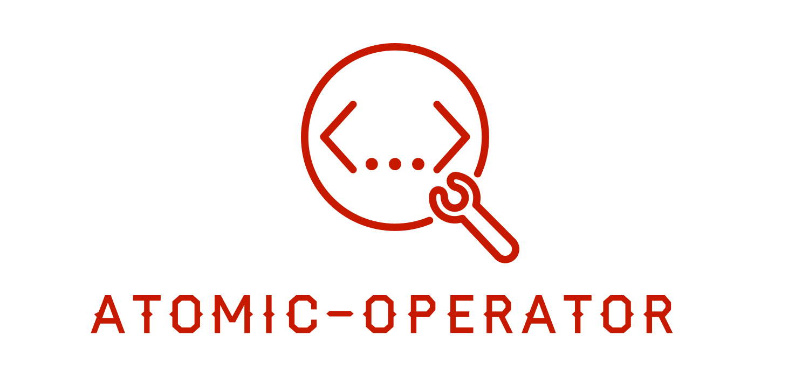

> Tradução automática local para português, ainda sem revisão humana integral. Estrutura e blocos de código preservados; referências externas não significam conteúdo espelhado.

[PyPI][pypi status]
[Status][pypi status]
[Python Version][pypi status]
[License][license]

[Read the documentation at https://atomic-operator.com/][read the docs]
[Code Quality & Tests](https://github.com/Swimlane/atomic-operator/actions/workflows/quality.yml)

[Black][black]

[status do pypi]: https://pypi.org/project/atomic-operator/
[Leia os documentos]: https://atomic-operator.com
[testes]: https://github.com/Swimlane/atomic-operator/actions?workflow=Quality
[codecov]: https://app.codecov.io/gh/Swimlane/atomic-operator
[pré-compromisso]: https://github.com/pre-commit/pre-commit
[preto]: https://github.com/psf/black

# atomic-operator



Este pacote python é usado para executar testes Atomic Red Team (Atomics) em vários ambientes do sistema operacional.

> ([O que há de novo?](https://github.com/swimlane/atomic-operator/blob/9756e4835e47c81b08be0bac5f2adcc3e9ad99c5/CHANGELOG.md))

<a id="why"></a>
## Porquê?

`atomic-operator` permite que os profissionais de segurança testem suas capacidades de detecção e defesa contra as técnicas prescritas definidas dentro do [Equipa atómica-vermelha](https://github.com/redcanaryco/atomic-red-team). Ao utilizar um framework de testes como o `atomic-operator`, você pode identificar tanto suas capacidades defensivas quanto lacunas na cobertura defensiva.

Além disso, `atomic-operator` pode ser usado em muitas outras situações como:

- Geração de alertas para produtos de teste
- Testes de RDE e outras ferramentas de segurança
- Identificar forma de realizar a evasão defensiva a partir de uma perspectiva de adversário
- E mais.

<a id="features"></a>
## Características

* Suporte à execução local e remota de testes Atomic Red Teams em sistemas Windows, macOS e Linux
* Suporta a execução de testes atômicos contra `iaas:aws`
* Pode solicitar argumentos de entrada, mas não é necessário
* Assistir ao download do repositório atômico-red-team
* Pode ser automatizado ainda mais com base em um arquivo de configuração
* Um pacote Python importável e de linha de comando
* Selecione testes específicos quando uma ou mais técnicas forem especificadas
* Procure em todos os atômicos por esse teste perfeito
* Passar input_arguments como input para testes via linha de comando
* Além de mais

<a id="getting-started"></a>
## Começar

`atomic-operator` é um pacote somente para Python hospedado no [PyPi](https://pypi.org/project/atomic-operator/) e trabalha com Python 3.6 e maior.

Se você está querendo uma versão PowerShell, por favor confira [Invoke-AtomicRedTeam](https://github.com/redcanaryco/invoke-atomicredteam).

```bash
pip install atomic-operator
```

Os próximos passos irão guiá-lo através da configuração e execução do `atomic-operator`.

* [Obter Atomics](https://github.com/swimlane/atomic-operator/blob/9756e4835e47c81b08be0bac5f2adcc3e9ad99c5/docs/atomics.md) Instalar / clonar o repositório Atomic Red Team
* [atômico-operador](https://github.com/swimlane/atomic-operator/blob/9756e4835e47c81b08be0bac5f2adcc3e9ad99c5/docs/atomic-operator.md) Compreenda as opções disponíveis no operador atômico
* [Executando Teste na Linha de Comando](https://github.com/swimlane/atomic-operator/blob/9756e4835e47c81b08be0bac5f2adcc3e9ad99c5/docs/running-tests-command-line.md) ou [Executando testes dentro de um script](https://github.com/swimlane/atomic-operator/blob/9756e4835e47c81b08be0bac5f2adcc3e9ad99c5/docs/running-tests-script.md)
* [Executando Testes via Arquivo de Configuração](https://github.com/swimlane/atomic-operator/blob/9756e4835e47c81b08be0bac5f2adcc3e9ad99c5/atomic-operator-config.md)

<a id="installation"></a>
## Instalação

Você pode instalar **atomic-operator** no OS X, Linux ou Windows. Você também pode instalá-lo diretamente a partir da fonte. Para instalar, veja os comandos sob o cabeçalho do sistema operacional relevante, abaixo.

<a id="prerequisites"></a>
### Pré-requisitos

As seguintes bibliotecas são necessárias e instaladas pelo operador atômico:

```text
pyyaml==5.4.1
fire==0.4.0
requests==2.26.0
attrs==21.2.0
pick==1.2.0
```

<a id="macos-linux-and-windows"></a>
### macOS, Linux e Windows:

```bash
pip install atomic-operator
```

<a id="macos-using-m1-processor"></a>
### macOS usando o processador M1

```bash
git clone https://github.com/swimlane/atomic-operator.git
cd atomic-operator

# Satisfy ModuleNotFoundError: No module named 'setuptools_rust'
brew install rust
pip3 install --upgrade pip
pip3 install setuptools_rust

# Back to our regularly scheduled programming . . .  
pip install -r requirements.txt
python setup.py install
```

<a id="installing-from-source"></a>
### Instalando do código fonte

```bash
git clone https://github.com/swimlane/atomic-operator.git
cd atomic-operator
pip install -r requirements.txt
python setup.py install
```

<a id="usage-example-command-line"></a>
## Exemplo de uso (linha de comando)

Você pode executar `atomic-operator` a partir da linha de comando ou dentro de seus próprios scripts Python. Para usar `atomic-operator` na linha de comando simplesmente digite o seguinte em seu terminal:

```bash
atomic-operator --help
atomic-operator run -- --help
```

> Por favor, note que para ver detalhes sobre o comando de execução execute `atomic-operator run -- --help` e NÃO `atomic-operator run --help`

<a id="retrieving-atomic-tests"></a>
### Recuperando Testes Atômicos

Para usar o `atomic-operator`, você deve ter um ou mais testes [Equipa atómica-vermelha](https://github.com/redcanaryco/atomic-red-team) (Atomics) no seu sistema local. O `atomic-operator` fornece-lhe a capacidade de baixar o repositório da Equipa Vermelha Atômica. Você pode fazê-lo executando o seguinte na linha de comando:

```bash
atomic-operator get_atomics 
# You can specify the destination directory by using the --destination flag
atomic-operator get_atomics --destination "/tmp/some_directory"
```

<a id="running-tests-locally"></a>
### Executando Testes Locais

Para executar um teste, você deve fornecer algumas propriedades adicionais (e opções, se desejar). O método principal para executar testes é chamado `run`.

```bash
# This will run ALL tests compatiable with your local operating system
atomic-operator run --atomics-path "/tmp/some_directory/redcanaryco-atomic-red-team-3700624"
```

Você pode selecionar testes individuais quando fornecer uma ou mais técnicas específicas. Por exemplo, executando o seguinte na linha de comando:

```bash
atomic-operator run --techniques T1564.001 --select_tests
```

Irá pedir ao usuário uma lista de seleção de testes associados a essa técnica. Um usuário pode selecionar um ou mais testes usando a barra de espaço para destacar o teste desejado:

```text
 Select Test(s) for Technique T1564.001 (Hide Artifacts: Hidden Files and Directories)

 * Create a hidden file in a hidden directory (61a782e5-9a19-40b5-8ba4-69a4b9f3d7be)
   Mac Hidden file (cddb9098-3b47-4e01-9d3b-6f5f323288a9)
   Create Windows System File with Attrib (f70974c8-c094-4574-b542-2c545af95a32)
   Create Windows Hidden File with Attrib (dadb792e-4358-4d8d-9207-b771faa0daa5)
   Hidden files (3b7015f2-3144-4205-b799-b05580621379)
   Hide a Directory (b115ecaf-3b24-4ed2-aefe-2fcb9db913d3)
   Show all hidden files (9a1ec7da-b892-449f-ad68-67066d04380c)
```

O seguinte lhe permitirá fornecer argumentos de entrada personalizados para testes. Você fará isso fornecendo um dicionário de chaves e valores como um dicionário para o parâmetro `input_arguments` no método de execução.

```bash
atomic-operator run --techniques T1564.001 --input_arguments '{"project-id": "some_value", "another_key": "another value"}'
# Please include single quotes around the input_arguments value.
```

<a id="running-tests-remotely"></a>
### Executando Testes Remotamente

Para executar um teste remotamente, você deve fornecer algumas propriedades adicionais (e opções se desejar). O método principal para executar testes é chamado `run`.

```bash
# This will run ALL tests compatiable with your local operating system
atomic-operator run --atomics-path "/tmp/some_directory/redcanaryco-atomic-red-team-3700624" --hosts "10.32.1.0" --username "my_username" --password "my_password"
```

> Ao executar comandos remotamente contra hosts do Windows, você pode precisar configurar o PSRemoting. Veja os detalhes aqui: [Remoção de Janelas](https://github.com/swimlane/atomic-operator/blob/9756e4835e47c81b08be0bac5f2adcc3e9ad99c5/docs/windows-remote.md)

<a id="additional-parameters"></a>
### Parâmetros adicionais

Você pode ver parâmetros adicionais executando o seguinte comando:

```bash
atomic-operator run -- --help
```


|Nome do Parâmetro|Tipo|Predefinição|Designação das mercadorias|
|--------------|----|-------|-----------|
|técnicas|lista|todos|Uma ou mais técnicas definidas por attack_technique ID.|
|test_ guids|lista|Nenhum|Um ou mais GUIDs de ensaio atómico.|
|selecionar_testes|bool|Falso|Selecione um ou mais testes atômicos para executar quando uma técnica é especificada.|
|caminho_ atômico|str|os.getcwd()|O caminho dos testes atómicos.|
|input_ arguments|dict|{}|Um dicionário de argumentos de entrada para passar para o teste.|
|check_prereqs|bool|Falso|Se deve ou não verificar as dependências pré-req (pré-req_comand).|
|get_prereqs|bool|Falso|Se você deseja ou não recuperar pré-requisitos.|
|limpeza|bool|Falso|Se deseja ou não executar os comandos de limpeza.|
|copy_source_files|bool|Verdadeiro|Se você deseja ou não copiar qualquer fonte relacionada (src, bin, etc.) arquivos para uma máquina remota.|
|comando_timeout|int|20|Duração do tempo para cada comando antes do tempo limite.|
|depurar|bool|Falso|Se você deseja ou não obter detalhes sobre os testes que estão sendo executados.|
|prompt_for_input_args|bool|Falso|Se deseja solicitar argumentos de entrada para cada teste.|
|Return_Atomics|bool|Falso|Se você quer ou não retornar a atômicos em vez de executá-los.|
|arquivo de configuração|str|Nenhum|Um caminho para um arquivo conifg_ que é usado para automatizar o operador atômico em ambientes.|
|config_file_only|bool|Falso|Se você deseja ou não executar testes com base apenas no arquivo de configuração fornecido.|
|máquinas|lista|Nenhum|Uma lista de uma ou mais máquinas remotas para executar um teste.|
|nome de usuário|str|Nenhum|Nome de usuário para autenticação de conexões remotas.|
|senha|str|Nenhum|Senha para autenticação de conexões remotas.|
|ssh_ key_ path|str|Nenhum|Caminho para uma chave SSH para autenticação de conexões remotas.|
|texto_ chave_ privado|str|Nenhum|Uma cadeia privada de chaves SSH usada para autenticação de conexões remotas.|
|verificar_ssl|bool|Falso|Verificar ou não o 'ssl' ao ligar- se sobre o RDP (janelas).|
|ssh_port|int|22|Porta SSH para autenticação de conexões remotas.|
|ssh_timeout|int|5|Tempo limite SSH para autenticação de conexões remotas.|
|**kwargs|dict|Nenhum|Se forem passados sinalizadores adicionais para o comando de execução, então tentaremos combiná-los com entradas definidas dentro de testes atômicos e substituir seu valor pelo valor fornecido.|


Você deve ver uma saída semelhante à seguinte:

```text
NAME
    atomic-operator run - The main method in which we run Atomic Red Team tests.

SYNOPSIS
    atomic-operator run <flags>

DESCRIPTION
    The main method in which we run Atomic Red Team tests.

FLAGS
    --techniques=TECHNIQUES
        Type: list
        Default: ['all']
        One or more defined techniques by attack_technique ID. Defaults to 'all'.
    --test_guids=TEST_GUIDS
        Type: list
        Default: []
        One or more Atomic test GUIDs. Defaults to None.
    --select_tests=SELECT_TESTS
        Type: bool
        Default: False
        Select one or more tests from provided techniques. Defaults to False.
    --atomics_path=ATOMICS_PATH
        Default: '/U...
        The path of Atomic tests. Defaults to os.getcwd().
    --input_arguments={}
        Default: {}
        A dictionary of input arguments to pass to the test.
    --check_prereqs=CHECK_PREREQS
        Default: False
        Whether or not to check for prereq dependencies (prereq_comand). Defaults to False.
    --get_prereqs=GET_PREREQS
        Default: False
        Whether or not you want to retrieve prerequisites. Defaults to False.
    --cleanup=CLEANUP
        Default: False
        Whether or not you want to run cleanup command(s). Defaults to False.
    --copy_source_files=COPY_SOURCE_FILES
        Default: True
        Whether or not you want to copy any related source (src, bin, etc.) files to a remote host. Defaults to True.
    --command_timeout=COMMAND_TIMEOUT
        Default: 20
        Timeout duration for each command. Defaults to 20.
    --debug=DEBUG
        Default: False
        Whether or not you want to output details about tests being ran. Defaults to False.
    --prompt_for_input_args=PROMPT_FOR_INPUT_ARGS
        Default: False
        Whether you want to prompt for input arguments for each test. Defaults to False.
    --return_atomics=RETURN_ATOMICS
        Default: False
        Whether or not you want to return atomics instead of running them. Defaults to False.
    --config_file=CONFIG_FILE
        Type: Optional[]
        Default: None
        A path to a conifg_file which is used to automate atomic-operator in environments. Default to None.
    --config_file_only=CONFIG_FILE_ONLY
        Default: False
        Whether or not you want to run tests based on the provided config_file only. Defaults to False.
    --hosts=HOSTS
        Default: []
        A list of one or more remote hosts to run a test on. Defaults to [].
    --username=USERNAME
        Type: Optional[]
        Default: None
        Username for authentication of remote connections. Defaults to None.
    --password=PASSWORD
        Type: Optional[]
        Default: None
        Password for authentication of remote connections. Defaults to None.
    --ssh_key_path=SSH_KEY_PATH
        Type: Optional[]
        Default: None
        Path to a SSH Key for authentication of remote connections. Defaults to None.
    --private_key_string=PRIVATE_KEY_STRING
        Type: Optional[]
        Default: None
        A private SSH Key string used for authentication of remote connections. Defaults to None.
    --verify_ssl=VERIFY_SSL
        Default: False
        Whether or not to verify ssl when connecting over RDP (windows). Defaults to False.
    --ssh_port=SSH_PORT
        Default: 22
        SSH port for authentication of remote connections. Defaults to 22.
    --ssh_timeout=SSH_TIMEOUT
        Default: 5
        SSH timeout for authentication of remote connections. Defaults to 5.
    Additional flags are accepted.
        If provided, keys matching inputs for a test will be replaced. Default is None.
```

<a id="running-atomic-operator-using-a-config_file"></a>
### Executando o operador atômico usando um arquivo de configuração

Além da capacidade de passar em parâmetros com `atomic-operator`, você também pode passar em um caminho para um `config_file` que contém todos os testes atômicos e suas entradas potenciais. Você pode ver um exemplo deste arquivo de configuração aqui:

```yaml
atomic_tests:
  - guid: f7e6ec05-c19e-4a80-a7e7-241027992fdb
    input_arguments:
      output_file:
        value: custom_output.txt
      input_file:
        value: custom_input.txt
  - guid: 3ff64f0b-3af2-3866-339d-38d9791407c3
    input_arguments:
        second_arg:
          value: SWAPPPED argument
  - guid: 32f90516-4bc9-43bd-b18d-2cbe0b7ca9b2
```

<a id="usage-example-scripts"></a>
## Exemplo de uso (scripts)

Para usar **atomic-operator** você deve instanciar um objeto **AtomicOperator**.

```python
from atomic_operator import AtomicOperator

operator = AtomicOperator()

# This will download a local copy of the atomic-red-team repository

print(operator.get_atomics('/tmp/some_directory'))

# this will run tests on your local system
operator.run(
    technique: str='All', 
    atomics_path=os.getcwd(), 
    check_dependencies=False, 
    get_prereqs=False, 
    cleanup=False, 
    command_timeout=20, 
    debug=False,
    prompt_for_input_args=False,
    **kwargs
)
```

<a id="getting-help"></a>
## Obter Ajuda

Por favor, crie um [questão](https://github.com/swimlane/atomic-operator/pulls) se tiver dúvidas ou tiver problemas.

<a id="built-with"></a>
## Construído com

* [carcaça](https://github.com/MSAdministrator/carcass) - Modelo de embalagem Python

<a id="contributing"></a>
## Contribuir

Por favor, leia [CONTRIBUIÇÃO. md](https://github.com/swimlane/atomic-operator/blob/9756e4835e47c81b08be0bac5f2adcc3e9ad99c5/CONTRIBUTING.md) para obter detalhes sobre nosso código de conduta, e o processo para enviar pedidos de pull para nós.

<a id="versioning"></a>
## Versionamento

Usamos [SemVer](http://semver.org/) para versionamento.

<a id="authors"></a>
## Autores

* Josh Rickard - *Obra inicial* - [MSAdministrator](https://github.com/MSAdministrator)

Veja também a lista de [contribuidores](https://github.com/swimlane/atomic-operator/contributors) que participaram deste projeto.

<a id="license"></a>
## Licença

Este projeto está licenciado sob a Licença MIT - consulte o arquivo [LICENÇA](../../99-Assets/upstream/atomic-operator/LICENSE.txt) para obter detalhes

<a id="shoutout"></a>
## Gritar

- Graças ao [keithmccammon](https://github.com/keithmccammon) por ajudar a identificar problemas com o processor baseado no macOS M1 e fornecer uma correção


---

## Procedência desta tradução

Fonte: [https://github.com/swimlane/atomic-operator](https://github.com/swimlane/atomic-operator/blob/9756e4835e47c81b08be0bac5f2adcc3e9ad99c5/README.md). Licença: [MIT](../../99-Assets/upstream/atomic-operator/LICENSE.txt). Commit: 9756e4835e47c81b08be0bac5f2adcc3e9ad99c5.

O original preservado, a lista de mudanças de apresentação e os hashes constam no manifesto do projeto. Nenhum exemplo desta documentação foi executado automaticamente.
