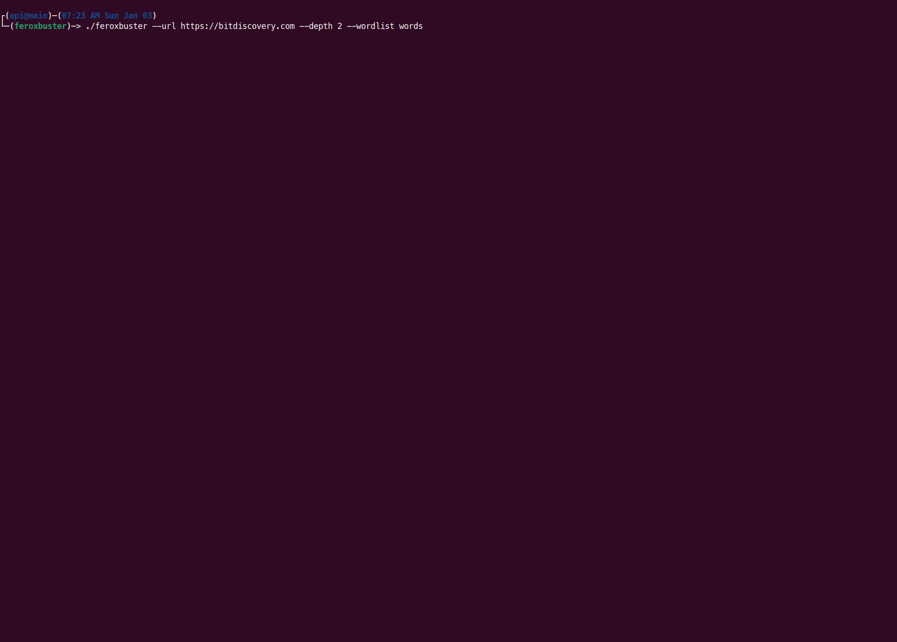

> Tradução automática local para português, ainda sem revisão humana integral. Estrutura e blocos de código preservados; referências externas não significam conteúdo espelhado.

# feroxbuster — documentação oficial

> [!WARNING]
> **Notificação de segurança – Personagem de domínio**
>
> O domínio **feroxbuster.com** é **NOT filiado** com este projeto, seus mantenedores ou quaisquer lançamentos oficiais de feroxbuster.
>
> Os downloads oficiais do feroxbuster são distribuídos por **ONLY** através de:
>
> - [https://github.com/epi052/feroxbuster](https://github.com/epi052/feroxbuster/releases) (fonte aberta)
> - [https://www.feroxbuster.pro](https://www.feroxbuster.pro) (comercial)
> - repositórios de pacotes listados neste README
> - repositórios de pacotes listados no [Documentos de instalação](https://epi052.github.io/feroxbuster-docs/installation/android/)
>
> Fazemos **not** distribuir software de feroxbuster.com, e não podemos garantir a autenticidade ou segurança dos arquivos hospedados lá.
> Se você baixou o feroxbuster de qualquer outro domínio, recomendamos fortemente deletá-lo e reinstalá-lo de uma fonte oficial.

<h1 align="center">
  <br>
  <a href="https://github.com/epi052/feroxbuster"></a>
  <br>
</h1>

<h4 align="center">A ferramenta de descoberta de conteúdo simples, rápida e recursiva escrita em Rust</h4>

<p align="center">
  <a href="https://github.com/epi052/feroxbuster/actions?query=workflow%3A%22CI+Pipeline%22">
    
  </a>

  <a href="https://github.com/epi052/feroxbuster/releases">
    
  </a>

  <a href="https://github.com/epi052/feroxbuster/commits/master">
    
  </a>

  <a href="https://crates.io/crates/feroxbuster">
    
  </a>

  <a href="https://crates.io/crates/feroxbuster">
    
  </a>

  <a href="https://codecov.io/gh/epi052/feroxbuster">
    
  </a>
  <!--
  <!-- ALL-CONTRIBUTORS-BADGE:START - Do not remove or modify this section 
    [All Contributors](#contribuidores)
  <!-- ALL-CONTRIBUTORS-BADGE:END -->
  <a href="https://github.com/epi052/feroxbuster/graphs/contributors">
    
  </a>

</p>



<p align="center">
  <a href="https://github.com/epi052/feroxbuster/releases"></a>&nbsp;
  <a href="https://epi052.github.io/feroxbuster-docs/examples/auto-tune/"></a>&nbsp;
  <a href="https://github.com/epi052/feroxbuster/blob/main/CONTRIBUTING.md"></a>&nbsp;
  <a href="https://epi052.github.io/feroxbuster-docs/overview"></a>&nbsp;
  <a href="https://www.feroxbuster.pro"></a>
</p>

---

> [!DICA]
> **ADocumentação mudou-se!** &mdash; Em vez de ter uma linha de 1300 `README.md` (desculpe...), a documentação do feroxbuster mudou-se para Páginas do GitHub. A mudança para a documentação de hospedagem nas Páginas deverá tornar muito mais fácil encontrar a informação que procura, seja ela qual for. Por favor, verifique se precisa de alguma coisa além de um arranque rápido.
>
> **[Ver a documentação completa &# 8594;](https://epi052.github.io/feroxbuster-docs/overview)**

<a id="what-the-heck-is-a-ferox-anyway"></a>
## O que raio é um ferox?

Ferox é diminutivo de óxido férrico. Óxido férrico, simplesmente colocado, é ferrugem. O nome ferrugem foi tomado, então eu decidi em um
variação.

<a id="whats-it-do-tho"></a>
## O que é que ele faz?

`feroxbuster` é uma ferramenta projetada para executar [Navegação Forçada](https://owasp.org/www-community/attacks/Forced_browsing).

Navegação forçada é um ataque onde o objetivo é enumerar e acessar recursos que não são referenciados pela web
aplicação, mas ainda são acessíveis por um atacante.

O `feroxbuster` usa força bruta combinada com uma lista de palavras para procurar por conteúdo desvinculado nas pastas de destino. Estes
os recursos podem armazenar informações sensíveis sobre aplicações web e sistemas operacionais, como o código-fonte,
credenciais, endereçamento de rede interna, etc...

Este ataque também é conhecido como Localização de Recurso Previsível, Enumeração de Arquivos, Enumeração de Diretórios e Recurso
Enumeração.

<a id="quick-start"></a>
## Início Rápido

Esta seção irá cobrir a quantidade mínima de informações para começar a funcionar com feroxbuster. Por favor, consulte o [documentação](https://epi052.github.io/feroxbuster-docs/overview/), pois é muito mais abrangente.

<a id="installation"></a>
### Instalação

Existem alguns outros [métodos de instalação](https://epi052.github.io/feroxbuster-docs/installation/android/), mas estes trechos devem cobrir a maioria dos usuários.

#### Kali

Se você estiver usando o kali, este é o método de instalação preferido. Instalar a partir do repos adiciona um [**ferox-config.toml**](https://epi052.github.io/feroxbuster-docs/configuration/ferox-config-toml/) no `/etc/feroxbuster/`, adiciona completamento de comando para bash, fish e zsh, inclui uma entrada de página man, e instala o `feroxbuster` em si.

```text
sudo apt update && sudo apt install -y feroxbuster
```

<a id="linux-32-and-64-bit--macos"></a>
#### Linux (32 e 64 bits) & MacOS

Instalar numa pasta específica
```text
curl -sL https://raw.githubusercontent.com/epi052/feroxbuster/main/install-nix.sh | bash -s $HOME/.local/bin
```

Instalar na pasta de trabalho atual
```text
curl -sL https://raw.githubusercontent.com/epi052/feroxbuster/main/install-nix.sh | bash
```

#### MacOS via Homebrew

```text
brew install feroxbuster
```

<a id="windows-x86_64"></a>
#### Janelas x86_ 64

```text
Invoke-WebRequest https://github.com/epi052/feroxbuster/releases/latest/download/x86_64-windows-feroxbuster.exe.zip -OutFile feroxbuster.zip
Expand-Archive .\feroxbuster.zip
.\feroxbuster\feroxbuster.exe -V
```

<a id="windows-via-winget"></a>
#### Janelas via Winget

```text
winget install epi052.feroxbuster
```

<a id="windows-via-chocolatey"></a>
#### Janelas via Chocolatey

```text
choco install feroxbuster
```

<a id="all-others"></a>
#### Todos os outros

Consulte o [documentação](https://epi052.github.io/feroxbuster-docs/overview).

<a id="updating-feroxbuster-new-in-v291"></a>
### Actualizando o feroxbuster (novo em v2.9.1)

```text
./feroxbuster --update
```

<a id="example-usage"></a>
## Uso do Exemplo

Aqui estão alguns exemplos breves para você começar. Por favor, note que o feroxbuster pode fazer um **lot mais** do que o que está listado abaixo. Como resultado, há **many mais exemplos **, com o **demonstration gifs** que destacam características específicas, no [documentação](https://epi052.github.io/feroxbuster-docs/overview).

<a id="multiple-values"></a>
### Valores Múltiplos

As opções que tomam vários valores são muito flexíveis. Considere as seguintes formas de especificar extensões:

```text
./feroxbuster -u http://127.1 -x pdf -x js,html -x php txt json,docx
```

O comando acima adiciona .pdf, .js, .html, .php, .txt, .json, e .docx para cada url

Todos os métodos acima (marcas múltiplas, espaço separado, vírgula separada, etc...) são válidos e intercambiáveis.
o mesmo vale para urls, cabeçalhos, códigos de status, consultas e filtros de tamanho.

<a id="include-headers"></a>
### Incluir os Cabeçalhos

```text
./feroxbuster -u http://127.1 -H Accept:application/json "Authorization: Bearer {token}"
```

<a id="ipv6-non-recursive-scan-with-info-level-logging-enabled"></a>
### Escaneamento IPv6, não recursivo com registro de nível INFO ativado

```text
./feroxbuster -u http://[::1] --no-recursion -vv
```

<a id="read-urls-from-stdin-pipe-only-resulting-urls-out-to-another-tool"></a>
### Leia urls de STDIN; pipe apenas resultante urls para outra ferramenta

```text
cat targets | ./feroxbuster --stdin --silent -s 200 301 302 --redirects -x js | fff -s 200 -o js-files
```

<a id="proxy-traffic-through-burp"></a>
### Tráfego de proxy através do Burp

```text
./feroxbuster -u http://127.1 --insecure --proxy http://127.0.0.1:8080
```

<a id="proxy-traffic-through-a-socks-proxy-including-dns-lookups"></a>
### Tráfego de proxy através de um proxy SOCKS (incluindo pesquisas DNS)

```text
./feroxbuster -u http://127.1 --proxy socks5h://127.0.0.1:9050
```

<a id="pass-auth-token-via-query-parameter"></a>
### Passar o token de autenticação através do parâmetro de consulta

```text
./feroxbuster -u http://127.1 --query token=0123456789ABCDEF
```

<a id="set-the-content-type-of-the-body-automatically-with---data-json---data-urlencoded"></a>
### Configure o tipo de conteúdo do corpo automaticamente com --data-json --data-urlencoded

```text
./feroxbuster -u http://127.1 --data-json '{"some": "payload"}'
./feroxbuster -u http://127.1 --data-json @payload.json
./feroxbuster -u http://127.1 --data-urlencoded 'some=payload'
./feroxbuster -u http://127.1 --data-urlencoded @file.payload
```

> [!DICA]
> Para realsies, havia mais de 1300 linhas neste README, mas tudo foi movido para o [novo site de documentação](https://epi052.github.io/feroxbuster-docs/overview). Confira Go!
>
> **[Ver a documentação completa &# 8594;](https://epi052.github.io/feroxbuster-docs/overview)**

<a id="contributors"></a>
## Contribuidores

Obrigado vai para essas pessoas maravilhosas ([chave emoji](https://allcontributors.org/docs/en/emoji-key)):

<!-- ALL-CONTRIBUTORS-LIST:START - Do not remove or modify this section -->
<!-- prettier-ignore-start -->
<!-- markdownlint-disable -->
<table>
  <tbody>
    <tr>
<td align="center" valign="top" width="14.28%"><a href="https://io.fi"><br /><sub><b>Joona Hoikkala</b></sub></a><br /><a href="https://github.com/epi052/feroxbuster/commits?author=joohoi" title="Documentation">📖</a></td>
            <td align="center" valign="top" width="14.28%"><a id="infra-jsav0"></a><a href="https://github.com/jsav0"><br /><sub><b>J Savage</b></sub></a><br /><a href="#infra-jsav0" title="Infrastructure (Hosting, Build-Tools, etc)">🚇</a>  <a href="https://github.com/epi052/feroxbuster/commits?author=jsav0" title="Documentation">📖</a></td>
<td align="center" valign="top" width="14.28%"><a id="infra-TGotwig"></a><a href="http://www.tgotwig.dev"><br /><sub><b>Thomas Gotwig</b></sub></a><br /><a href="#infra-TGotwig" title="Infrastructure (Hosting, Build-Tools, etc)">🚇</a> <a href="https://github.com/epi052/feroxbuster/commits?author=TGotwig" title="Documentation">📖</a></td>
            <td align="center" valign="top" width="14.28%"><a id="infra-spikecodes"></a><a href="https://github.com/spikecodes"><br /><sub><b>Spike</b></sub></a><br /><a href="#infra-spikecodes" title="Infrastructure (Hosting, Build-Tools, etc)">🚇</a>  <a href="https://github.com/epi052/feroxbuster/commits?author=spikecodes" title="Documentation">📖</a></td>
            <td align="center" valign="top" width="14.28%"><a href="https://github.com/evanrichter"><br /><sub><b>Evan Richter</b></sub></a><br /><a href="https://github.com/epi052/feroxbuster/commits?author=evanrichter" title="Code">💻</a>  <a href="https://github.com/epi052/feroxbuster/commits?author=evanrichter" title="Documentation">📖</a></td>
<td align="center" valign="top" width="14.28%"><a id="ideas-mzpqnxow"></a><a href="https://github.com/mzpqnxow"><br /><sub><b>AG</b></sub></a><br /><a href="#ideas-mzpqnxow" title="Ideas, Planning, & Feedback">🤔</a> <a href="https://github.com/epi052/feroxbuster/commits?author=mzpqnxow" title="Documentation">📖</a></td>
<td align="center" valign="top" width="14.28%"><a href="https://n-thumann.de/"><br /><sub><b>Nicolas Thumann</b></sub></a><br /><a href="https://github.com/epi052/feroxbuster/commits?author=n-thumann" title="Code">💻</a> <a href="https://github.com/epi052/feroxbuster/commits?author=n-thumann" title="Documentation">📖ZXZ</a></td>
    </tr>
    <tr>
            <td align="center" valign="top" width="14.28%"><a href="https://github.com/tomtastic"><br /><sub><b>Tom Matthews</b></sub></a><br /><a href="https://github.com/epi052/feroxbuster/commits?author=tomtastic" title="Documentation">📖</a></td>
            <td align="center" valign="top" width="14.28%"><a href="https://github.com/bsysop"><br /><sub><b>bsysop</b></sub></a><br /><a href="https://github.com/epi052/feroxbuster/commits?author=bsysop" title="Documentation">📖</a></td>
            <td align="center" valign="top" width="14.28%"><a href="http://bpsizemore.me"><br /><sub><b>Brian Sizemore</b></sub></a><br /><a href="https://github.com/epi052/feroxbuster/commits?author=bpsizemore" title="Code">💻</a></td>
            <td align="center" valign="top" width="14.28%"><a id="infra-noraj"></a><a href="https://pwn.by/noraj"><br /><sub><b>Alexandre ZANNI</b></sub></a><br /><a href="#infra-noraj" title="Infrastructure (Hosting, Build-Tools, etc)">🚇</a>  <a href="https://github.com/epi052/feroxbuster/commits?author=noraj" title="Documentation">📖</a></td>
            <td align="center" valign="top" width="14.28%"><a id="infra-craig"></a><a href="https://github.com/craig"><br /><sub><b>Craig</b></sub></a><br /><a href="#infra-craig" title="Infrastructure (Hosting, Build-Tools, etc)">🚇</a></td>
            <td align="center" valign="top" width="14.28%"><a id="infra-EONRaider"></a><a href="https://www.reddit.com/u/EONRaider"><br /><sub><b>EONRaider</b></sub></a><br /><a href="#infra-EONRaider" title="Infrastructure (Hosting, Build-Tools, etc)">🚇</a></td>
<td align="center" valign="top" width="14.28%"><a id="infra-wtwver"></a><a href="https://github.com/wtwver"><br /><sub><b>wtwver</b></sub></a><br /><a href="#infra-wtwver" title="Infrastructure (Hosting, Build-Tools, etc)">🚇</a></td>
    </tr>
    <tr>
            <td align="center" valign="top" width="14.28%"><a id="ideas-Tib3rius"></a><a href="https://tib3rius.com"><br /><sub><b>Tib3rius</b></sub></a><br /><a href="https://github.com/epi052/feroxbuster/issues?q=author%3ATib3rius" title="Bug reports">🐛</a>  <a href="#ideas-Tib3rius" title="Ideas, Planning, & Feedback">🤔</a></td>
<td align="center" valign="top" width="14.28%"><a href="https://github.com/0xdf"><br /><sub><b>0xdf</b></sub></a><br /><a href="https://github.com/epi052/feroxbuster/issues?q=author%3A0xdf" title="Bug reports">🐛</a></td>
<td align="center" valign="top" width="14.28%"><a href="http://secure77.de"><br /><sub><b>secure-77</b></sub></a><br /><a href="https://github.com/epi052/feroxbuster/issues?q=author%3Asecure-77" title="Bug reports">🐛</a></td>
<td align="center" valign="top" width="14.28%"><a id="infra-sbrun"></a><a href="https://github.com/sbrun"><br /><sub><b>Sophie Brun</b></sub></a><br /><a href="#infra-sbrun" title="Infrastructure (Hosting, Build-Tools, etc)">🚇</a></td>
<td align="center" valign="top" width="14.28%"><a id="ideas-black-A"></a><a href="https://github.com/black-A"><br /><sub><b>black-A</b></sub></a><br /><a href="#ideas-black-A" title="Ideas, Planning, & Feedback">🤔</a></td>
<td align="center" valign="top" width="14.28%"><a id="ideas-dinosn"></a><a href="https://github.com/dinosn"><br /><sub><b>Nicolas Krassas</b></sub></a><br /><a href="#ideas-dinosn" title="Ideas, Planning, & Feedback">🤔</a></td>
            <td align="center" valign="top" width="14.28%"><a id="ideas-N0ur5"></a><a href="https://github.com/N0ur5"><br /><sub><b>N0ur5</b></sub></a><br /><a href="#ideas-N0ur5" title="Ideas, Planning, & Feedback">🤔</a>  <a href="https://github.com/epi052/feroxbuster/issues?q=author%3AN0ur5" title="Bug reports">🐛</a></td>
    </tr>
    <tr>
            <td align="center" valign="top" width="14.28%"><a href="https://github.com/moscowchill"><br /><sub><b>mchill</b></sub></a><br /><a href="https://github.com/epi052/feroxbuster/issues?q=author%3Amoscowchill" title="Bug reports">🐛</a></td>
            <td align="center" valign="top" width="14.28%"><a href="http://BitThr3at.github.io"><br /><sub><b>Naman</b></sub></a><br /><a href="https://github.com/epi052/feroxbuster/issues?q=author%3ABitThr3at" title="Bug reports">🐛</a></td>
<td align="center" valign="top" width="14.28%"><a href="https://github.com/Sicks3c"><br /><sub><b>Ayoub Elaich</b></sub></a><br /><a href="https://github.com/epi052/feroxbuster/issues?q=author%3Asicks3c" title="Bug reports">🐛</a></td>
            <td align="center" valign="top" width="14.28%"><a href="https://github.com/HenryHoggard"><br /><sub><b>Henry</b></sub></a><br /><a href="https://github.com/epi052/feroxbuster/issues?q=author%3AHenryHoggard" title="Bug reports">🐛</a></td>
<td align="center" valign="top" width="14.28%"><a href="https://github.com/SleepiPanda"><br /><sub><b>SleepiPanda</b></sub></a><br /><a href="https://github.com/epi052/feroxbuster/issues?q=author%3ASleepiPanda" title="Bug reports">🐛</a></td>
            <td align="center" valign="top" width="14.28%"><a href="https://github.com/uBadRequest"><br /><sub><b>Pedidos Maus</b></sub></a><br /><a href="https://github.com/epi052/feroxbuster/issues?q=author%3AuBadRequest" title="Bug reports">🐛</a></td>
<td align="center" valign="top" width="14.28%"><a id="infra-dnaka91"></a><a href="https://home.dnaka91.rocks"><br /><sub><b>Dominik Nakamura</b></sub></a><br /><a href="#infra-dnaka91" title="Infrastructure (Hosting, Build-Tools, etc)">🚇</a></td>
    </tr>
    <tr>
<td align="center" valign="top" width="14.28%"><a href="https://github.com/hunter0x8"><br /><sub><b>Muhammad Ahsan</b></sub></a><br /><a href="https://github.com/epi052/feroxbuster/issues?q=author%3Ahunter0x8" title="Bug reports">🐛</a></td>
            <td align="center" valign="top" width="14.28%"><a href="https://github.com/cortantief"><br /><sub><b>cortantief</b></sub></a><br /><a href="https://github.com/epi052/feroxbuster/issues?q=author%3Acortantief" title="Bug reports">🐛</a>  <a href="https://github.com/epi052/feroxbuster/commits?author=cortantief" title="Code">💻</a></td>
            <td align="center" valign="top" width="14.28%"><a id="ideas-dsaxton"></a><a href="https://github.com/dsaxton"><br /><sub><b>Daniel Saxton</b></sub></a><br /><a href="#ideas-dsaxton" title="Ideas, Planning, & Feedback">🤔</a>  <a href="https://github.com/epi052/feroxbuster/commits?author=dsaxton" title="Code">💻</a></td>
            <td align="center" valign="top" width="14.28%"><a id="ideas-n0kovo"></a><a href="https://github.com/n0kovo"><br /><sub><b>n0kovo</b></sub></a><br /><a href="#ideas-n0kovo" title="Ideas, Planning, & Feedback">🤔</a>  <a href="https://github.com/epi052/feroxbuster/issues?q=author%3An0kovo" title="Bug reports">🐛</a></td>
            <td align="center" valign="top" width="14.28%"><a id="ideas-justinsteven"></a><a href="https://ring0.lol"><br /><sub><b>Justin Steven</b></sub></a><br /><a href="#ideas-justinsteven" title="Ideas, Planning, & Feedback">🤔</a></td>
<td align="center" valign="top" width="14.28%"><a href="https://github.com/7047payloads"><br /><sub><b>7047carregamentos</b></sub></a><br /><a href="https://github.com/epi052/feroxbuster/commits?author=7047payloads" title="Code">💻</a></td>
            <td align="center" valign="top" width="14.28%"><a id="ideas-unkn0wnsyst3m"></a><a href="https://github.com/unkn0wnsyst3m"><br /><sub><b>unkn0wnsyst3m</b></sub></a><br /><a href="#ideas-unkn0wnsyst3m" title="Ideas, Planning, & Feedback">🤔</a></td>
    </tr>
    <tr>
            <td align="center" valign="top" width="14.28%"><a id="ideas-its0x08"></a><a href="https://ironwort.me/"><br /><sub><b>0x08</b></sub></a><br /><a href="#ideas-its0x08" title="Ideas, Planning, & Feedback">🤔</a></td>
            <td align="center" valign="top" width="14.28%"><a id="ideas-MD-Levitan"></a><a href="https://github.com/MD-Levitan"><br /><sub><b>kusok</b></sub></a><br /><a href="#ideas-MD-Levitan" title="Ideas, Planning, & Feedback">🤔</a>  <a href="https://github.com/epi052/feroxbuster/commits?author=MD-Levitan" title="Code">💻</a></td>
            <td align="center" valign="top" width="14.28%"><a id="ideas-godylockz"></a><a href="https://github.com/godylockz"><br /><sub><b>godylockz</b></sub></a><br /><a href="#ideas-godylockz" title="Ideas, Planning, & Feedback">🤔</a>  <a href="https://github.com/epi052/feroxbuster/commits?author=godylockz" title="Code">💻</a></td>
            <td align="center" valign="top" width="14.28%"><a id="ideas-0dayCTF"></a><a href="http://ryanmontgomery.me"><br /><sub><b>Ryan Montgomery</b></sub></a><br /><a href="#ideas-0dayCTF" title="Ideas, Planning, & Feedback">🤔</a></td>
            <td align="center" valign="top" width="14.28%"><a id="ideas-ippsec"></a><a href="https://github.com/IppSec"><br /><sub><b>ippsec</b></sub></a><br /><a href="#ideas-ippsec" title="Ideas, Planning, & Feedback">🤔</a></td>
<td align="center" valign="top" width="14.28%"><a href="https://github.com/gtjamesa"><br /><sub><b>James</b></sub></a><br /><a href="https://github.com/epi052/feroxbuster/issues?q=author%3Agtjamesa" title="Bug reports">🐛</a></td>
            <td align="center" valign="top" width="14.28%"><a id="ideas-jhaddix"></a><a href="https://twitter.com/Jhaddix"><br /><sub><b>Jason Haddix</b></sub></a><br /><a href="#ideas-jhaddix" title="Ideas, Planning, & Feedback">🤔</a>  <a href="https://github.com/epi052/feroxbuster/issues?q=author%3Ajhaddix" title="Bug reports">🐛</a></td>
    </tr>
    <tr>
            <td align="center" valign="top" width="14.28%"><a href="https://github.com/ThisLimn0"><br /><sub><b>Limn0</b></sub></a><br /><a href="https://github.com/epi052/feroxbuster/issues?q=author%3AThisLimn0" title="Bug reports">🐛</a></td>
            <td align="center" valign="top" width="14.28%"><a id="ideas-0xdf223"></a><a href="https://github.com/0xdf223"><br /><sub><b>0xdf</b></sub></a><br /><a href="https://github.com/epi052/feroxbuster/issues?q=author%3A0xdf223" title="Bug reports">🐛</a>  <a href="#ideas-0xdf223" title="Ideas, Planning, & Feedback">🤔</a></td>
            <td align="center" valign="top" width="14.28%"><a id="ideas-Flangyver"></a><a href="https://github.com/Flangyver"><br /><sub><b>Flangyver</b></sub></a><br /><a href="#ideas-Flangyver" title="Ideas, Planning, & Feedback">🤔</a></td>
<td align="center" valign="top" width="14.28%"><a id="ideas-DonatoReis"></a><a href="https://github.com/DonatoReis"><br /><sub><b>PeakyBlinder</b></sub></a><br /><a href="#ideas-DonatoReis" title="Ideas, Planning, & Feedback">🤔</a></td>
            <td align="center" valign="top" width="14.28%"><a id="ideas-postmodern"></a><a href="https://postmodern.github.io/"><br /><sub><b>Pós-moderno</b></sub></a><br /><a href="#ideas-postmodern" title="Ideas, Planning, & Feedback">🤔</a></td>
      <td align="center" valign="top" width="14.28%"><a href="https://github.com/herrcykel"><br /><sub><b>O</b></sub></a><br /><a href="https://github.com/epi052/feroxbuster/commits?author=herrcykel" title="Code">💻</a></td>
<td align="center" valign="top" width="14.28%"><a href="http://udoprog.github.io/"><br /><sub><b>John-John Tedro</b></sub></a><br /><a href="https://github.com/epi052/feroxbuster/commits?author=udoprog" title="Code">💻</a></td>
    </tr>
    <tr>
            <td align="center" valign="top" width="14.28%"><a href="https://github.com/kmanc"><br /><sub><b>kmanc</b></sub></a><br /><a href="https://github.com/epi052/feroxbuster/issues?q=author%3Akmanc" title="Bug reports">🐛</a>  <a href="https://github.com/epi052/feroxbuster/commits?author=kmanc" title="Code">💻</a></td>
            <td align="center" valign="top" width="14.28%"><a id="ideas-hakdogpinas"></a><a href="https://github.com/hakdogpinas"><br /><sub><b>hakdogpinas</b></sub></a><br /><a href="#ideas-hakdogpinas" title="Ideas, Planning, & Feedback">🤔</a></td>
            <td align="center" valign="top" width="14.28%"><a id="ideas-duokebei"></a><a href="https://github.com/duokebei"><br /><sub><b>多可悲</b></sub></a><br /><a href="#ideas-duokebei" title="Ideas, Planning, & Feedback">🤔</a></td>
            <td align="center" valign="top" width="14.28%"><a id="infra-aidanhall34"></a><a href="https://blog.ah34.net/"><br /><sub><b>Aidan Hall</b></sub></a><br /><a href="https://github.com/epi052/feroxbuster/commits?author=aidanhall34" title="Code">💻</a>  <a href="#infra-aidanhall34" title="Infrastructure (Hosting, Build-Tools, etc)">🚇</a></td>
            <td align="center" valign="top" width="14.28%"><a id="ideas-joaociocca"></a><a href="https://hachyderm.io/@JohnnyCiocca"><br /><sub><b>João Ciocca</b></sub></a><br /><a href="https://github.com/epi052/feroxbuster/issues?q=author%3Ajoaociocca" title="Bug reports">🐛</a>  <a href="#ideas-joaociocca" title="Ideas, Planning, & Feedback">🤔</a></td>
<td align="center" valign="top" width="14.28%"><a href="https://github.com/f3rn0s"><br /><sub><b>f3rn0s</b></sub></a><br /><a href="https://github.com/epi052/feroxbuster/issues?q=author%3Af3rn0s" title="Bug reports">🐛</a></td>
<td align="center" valign="top" width="14.28%"><a id="ideas-pich4ya"></a><a href="https://sth.sh"><br /><sub><b>LongCat</b></sub></a><br /><a href="#ideas-pich4ya" title="Ideas, Planning, & Feedback">🤔</a></td>
    </tr>
    <tr>
            <td align="center" valign="top" width="14.28%"><a id="ideas-xaeroborg"></a><a href="https://github.com/xaeroborg"><br /><sub><b>xaeroborg</b></sub></a><br /><a href="#ideas-xaeroborg" title="Ideas, Planning, & Feedback">🤔</a></td>
<td align="center" valign="top" width="14.28%"><a id="ideas-Luoooio"></a><a href="https://github.com/Luoooio"><br /><sub><b>Luooio</b></sub></a><br /><a href="#ideas-Luoooio" title="Ideas, Planning, & Feedback">🤔</a></td>
            <td align="center" valign="top" width="14.28%"><a id="ideas-aancw"></a><a id="infra-aancw"></a><a href="https://petruknisme.com"><br /><sub><b>Aan</b></sub></a><br /><a href="https://github.com/epi052/feroxbuster/commits?author=aancw" title="Code">💻</a>  <a href="#infra-aancw" title="Infrastructure (Hosting, Build-Tools, etc)">🚇</a>  <a href="#ideas-aancw" title="Ideas, Planning, & Feedback">🤔</a></td>
            <td align="center" valign="top" width="14.28%"><a href="https://github.com/imBigo"><br /><sub><b>Simon</b></sub></a><br /><a href="https://github.com/epi052/feroxbuster/issues?q=author%3AimBigo" title="Bug reports">🐛</a></td>
<td align="center" valign="top" width="14.28%"><a href="https://acut3.github.io/"><br /><sub><b>Nicolas Christin</b></sub></a><br /><a href="https://github.com/epi052/feroxbuster/issues?q=author%3Aacut3" title="Bug reports">🐛</a></td>
            <td align="center" valign="top" width="14.28%"><a href="https://github.com/DrorDvash"><br /><sub><b>DrDv</b></sub></a><br /><a href="https://github.com/epi052/feroxbuster/issues?q=author%3ADrorDvash" title="Bug reports">🐛</a></td>
<td align="center" valign="top" width="14.28%"><a id="ideas-aroly"></a><a href="https://github.com/aroly"><br /><sub><b>Antoine Roly</b></sub></a><br /><a href="#ideas-aroly" title="Ideas, Planning, & Feedback">🤔</a></td>
    </tr>
    <tr>
            <td align="center" valign="top" width="14.28%"><a id="ideas-lavafroth"></a><a href="http://lavafroth.is-a.dev"><br /><sub><b>Himadri Bhattacharjee</b></sub></a><br /><a href="https://github.com/epi052/feroxbuster/commits?author=lavafroth" title="Code">💻</a>  <a href="#ideas-lavafroth" title="Ideas, Planning, & Feedback">🤔</a></td>
<td align="center" valign="top" width="14.28%"><a id="ideas-AkechiShiro"></a><a href="https://github.com/AkechiShiro"><br /><sub><b>Samy Lahfa</b></sub></a><br /><a href="#ideas-AkechiShiro" title="Ideas, Planning, & Feedback">🤔</a></td>
            <td align="center" valign="top" width="14.28%"><a id="ideas-sectroyer"></a><a href="https://github.com/sectroyer"><br /><sub><b>sectroyer</b></sub></a><br /><a href="https://github.com/epi052/feroxbuster/issues?q=author%3Asectroyer" title="Bug reports">🐛</a>  <a href="#ideas-sectroyer" title="Ideas, Planning, & Feedback">🤔</a></td>
<td align="center" valign="top" width="14.28%"><a href="https://medium.com/@b3rm1nG"><br /><sub><b>ktecv2000</b></sub></a><br /><a href="https://github.com/epi052/feroxbuster/issues?q=author%3Aktecv2000" title="Bug reports">🐛</a></td>
<td align="center" valign="top" width="14.28%"><a href="http://untrue.me"><br /><sub><b>Andrea De Murtas</b></sub></a><br /><a href="https://github.com/epi052/feroxbuster/commits?author=andreademurtas" title="Code">💻</a></td>
<td align="center" valign="top" width="14.28%"><a href="https://github.com/sawmj"><br /><sub><b>sawmj</b></sub></a><br /><a href="https://github.com/epi052/feroxbuster/issues?q=author%3Asawmj" title="Bug reports">🐛</a></td>
            <td align="center" valign="top" width="14.28%"><a href="https://github.com/devx00"><br /><sub><b>Zach Hanson</b></sub></a><br /><a href="https://github.com/epi052/feroxbuster/issues?q=author%3Adevx00" title="Bug reports">🐛</a></td>
    </tr>
    <tr>
            <td align="center" valign="top" width="14.28%"><a id="ideas-ocervell"></a><a href="https://github.com/ocervell"><br /><sub><b>Olivier Cervello</b></sub></a><br /><a href="#ideas-ocervell" title="Ideas, Planning, & Feedback">🤔</a></td>
<td align="center" valign="top" width="14.28%"><a id="ideas-RavySena"></a><a href="https://github.com/RavySena"><br /><sub><b>RavySena</b></sub></a><br /><a href="#ideas-RavySena" title="Ideas, Planning, & Feedback">🤔</a></td>
<td align="center" valign="top" width="14.28%"><a href="https://github.com/stuhlmann"><br /><sub><b>Florian Stuhlmann</b></sub></a><br /><a href="https://github.com/epi052/feroxbuster/issues?q=author%3Astuhlmann" title="Bug reports">🐛</a></td>
<td align="center" valign="top" width="14.28%"><a id="ideas-Mister7F"></a><a href="https://github.com/Mister7F"><br /><sub><b>Mester7F</b></sub></a><br /><a href="#ideas-Mister7F" title="Ideas, Planning, & Feedback">🤔</a></td>
            <td align="center" valign="top" width="14.28%"><a href="https://github.com/manugramm"><br /><sub><b>manugramm</b></sub></a><br /><a href="https://github.com/epi052/feroxbuster/issues?q=author%3Amanugramm" title="Bug reports">🐛</a></td>
<td align="center" valign="top" width="14.28%"><a href="https://github.com/ArthurMuraro"><br /><sub><b>ArthurMuraro</b></sub></a><br /><a href="https://github.com/epi052/feroxbuster/issues?q=author%3AArthurMuraro" title="Bug reports">🐛</a></td>
            <td align="center" valign="top" width="14.28%"><a href="https://github.com/amiremami"><br /><sub><b>Sombra</b></sub></a><br /><a href="https://github.com/epi052/feroxbuster/issues?q=author%3Aamiremami" title="Bug reports">🐛</a></td>
    </tr>
    <tr>
<td align="center" valign="top" width="14.28%"><a href="https://github.com/dirhamgithub"><br /><sub><b>dirhamgithub</b></sub></a><br /><a href="https://github.com/epi052/feroxbuster/issues?q=author%3Adirhamgithub" title="Bug reports">🐛</a></td>
<td align="center" valign="top" width="14.28%"><a id="infra-FieldOfRice"></a><a href="https://github.com/FieldOfRice"><br /><sub><b>FieldOfRice</b></sub></a><br /><a href="#infra-FieldOfRice" title="Infrastructure (Hosting, Build-Tools, etc)">🚇</a></td>
<td align="center" valign="top" width="14.28%"><a id="ideas-NotoriousRebel"></a><a href="https://github.com/NotoriousRebel"><br /><sub><b>Matt</b></sub></a><br /><a href="#ideas-NotoriousRebel" title="Ideas, Planning, & Feedback">🤔</a></td>
            <td align="center" valign="top" width="14.28%"><a href="https://github.com/tritoke"><br /><sub><b>Sam Leonard</b></sub></a><br /><a href="https://github.com/epi052/feroxbuster/commits?author=tritoke" title="Code">💻</a></td>
            <td align="center" valign="top" width="14.28%"><a id="ideas-rew1nter"></a><a href="https://github.com/rew1nter"><br /><sub><b>Reinverno</b></sub></a><br /><a href="#ideas-rew1nter" title="Ideas, Planning, & Feedback">🤔</a></td>
            <td align="center" valign="top" width="14.28%"><a id="ideas-deadloot"></a><a href="https://github.com/deadloot"><br /><sub><b>Deadloot</b></sub></a><br /><a href="#ideas-deadloot" title="Ideas, Planning, & Feedback">🤔</a></td>
            <td align="center" valign="top" width="14.28%"><a id="ideas-Spidle"></a><a href="https://github.com/Spidle"><br /><sub><b>Especiaria</b></sub></a><br /><a href="#ideas-Spidle" title="Ideas, Planning, & Feedback">🤔</a></td>
    </tr>
    <tr>
            <td align="center" valign="top" width="14.28%"><a id="ideas-JulianGR"></a><a id="infra-JulianGR"></a><a href="https://github.com/JulianGR"><br /><sub><b>Julián Gómez</b></sub></a><br /><a href="#ideas-JulianGR" title="Ideas, Planning, & Feedback">🤔</a>  <a href="#infra-JulianGR" title="Infrastructure (Hosting, Build-Tools, etc)">🚇</a>  <a href="https://github.com/epi052/feroxbuster/commits?author=JulianGR" title="Documentation">📖</a></td>
            <td align="center" valign="top" width="14.28%"><a href="https://github.com/soutzis"><br /><sub><b>Petros</b></sub></a><br /><a href="https://github.com/epi052/feroxbuster/issues?q=author%3Asoutzis" title="Bug reports">🐛</a></td>
            <td align="center" valign="top" width="14.28%"><a id="infra-sitiom"></a><a href="https://github.com/sitiom"><br /><sub><b>Ryan.</b></sub></a><br /><a href="#infra-sitiom" title="Infrastructure (Hosting, Build-Tools, etc)">🚇</a>  <a href="https://github.com/epi052/feroxbuster/commits?author=sitiom" title="Documentation">📖</a></td>
            <td align="center" valign="top" width="14.28%"><a id="ideas-wikamp-collaborator"></a><a id="infra-wikamp-collaborator"></a><a href="https://github.com/wikamp-collaborator"><br /><sub><b>colaborador wikamp</b></sub></a><br /><a href="#ideas-wikamp-collaborator" title="Ideas, Planning, & Feedback">🤔</a>  <a href="#infra-wikamp-collaborator" title="Infrastructure (Hosting, Build-Tools, etc)">🚇</a></td>
            <td align="center" valign="top" width="14.28%"><a id="ideas-L1-0"></a><a href="http://lino.codes"><br /><sub><b>Lino</b></sub></a><br /><a href="https://github.com/epi052/feroxbuster/issues?q=author%3AL1-0" title="Bug reports">🐛</a>  <a href="#ideas-L1-0" title="Ideas, Planning, & Feedback">🤔</a></td>
            <td align="center" valign="top" width="14.28%"><a id="ideas-sa7mon"></a><a href="https://danthesalmon.com"><br /><sub><b>Dan Salmon</b></sub></a><br /><a href="#ideas-sa7mon" title="Ideas, Planning, & Feedback">🤔</a></td>
<td align="center" valign="top" width="14.28%"><a id="ideas-swordfish0x0"></a><a href="https://github.com/swordfish0x0"><br /><sub><b>swordfish0x0</b></sub></a><br /><a href="#ideas-swordfish0x0" title="Ideas, Planning, & Feedback">🤔</a></td>
    </tr>
    <tr>
<td align="center" valign="top" width="14.28%"><a id="ideas-libklein"></a><a href="https://github.com/libklein"><br /><sub><b>Patrick Klein</b></sub></a><br /><a href="#ideas-libklein" title="Ideas, Planning, & Feedback">🤔</a></td>
            <td align="center" valign="top" width="14.28%"><a id="ideas-Raymond-JV"></a><a href="https://github.com/Raymond-JV"><br /><sub><b>Raymond</b></sub></a><br /><a href="#ideas-Raymond-JV" title="Ideas, Planning, & Feedback">🤔</a></td>
<td align="center" valign="top" width="14.28%"><a href="https://github.com/zer0x64"><br /><sub><b>zer0x64</b></sub></a><br /><a href="https://github.com/epi052/feroxbuster/commits?author=zer0x64" title="Code">💻</a></td>
            <td align="center" valign="top" width="14.28%"><a id="ideas-zar3bski"></a><a href="https://zar3bski.com"><br /><sub><b>zar3bski</b></sub></a><br /><a href="https://github.com/epi052/feroxbuster/commits?author=zar3bski" title="Code">💻</a>  <a href="#ideas-zar3bski" title="Ideas, Planning, & Feedback">🤔</a></td>
            <td align="center" valign="top" width="14.28%"><a href="https://github.com/karanabe"><br /><sub><b>karanabe</b></sub></a><br /><a href="https://github.com/epi052/feroxbuster/commits?author=karanabe" title="Documentation">📖</a>  <a href="https://github.com/epi052/feroxbuster/commits?author=karanabe" title="Code">💻</a></td>
            <td align="center" valign="top" width="14.28%"><a id="ideas-h121h"></a><a href="https://github.com/h121h"><br /><sub><b>h121h</b></sub></a><br /><a href="#ideas-h121h" title="Ideas, Planning, & Feedback">🤔</a></td>
            <td align="center" valign="top" width="14.28%"><a id="ideas-s0i37"></a><a href="https://github.com/s0i37"><br /><sub><b>s0i37</b></sub></a><br /><a href="#ideas-s0i37" title="Ideas, Planning, & Feedback">🤔</a></td>
    </tr>
    <tr>
            <td align="center" valign="top" width="14.28%"><a href="https://github.com/wilco375"><br /><sub><b>Wilco</b></sub></a><br /><a href="https://github.com/epi052/feroxbuster/issues?q=author%3Awilco375" title="Bug reports">🐛</a></td>
<td align="center" valign="top" width="14.28%"><a href="https://github.com/HenriBom"><br /><sub><b>HenriBom</b></sub></a><br /><a href="https://github.com/epi052/feroxbuster/issues?q=author%3AHenriBom" title="Bug reports">🐛</a></td>
            <td align="center" valign="top" width="14.28%"><a id="ideas-0x7274"></a><a href="https://github.com/0x7274"><br /><sub><b>R̝͖̱͖͕̤̰̯͙ͫ͒̀ͮȁ̤͔̝̘̪̻͕̝̖ͧͪͤu̗̠̜̩̗͇͑̀ͣ̃͂̔͂c̫͔͚̲̬̓̂̿͌̿͊̐͗h͚̲̤̟͓̟̥̊ͬͪ̏̍̍ T̟̜̞͉͙̙ͣ́ͪ͗̓̇ͭo͍̰͎̼͓̟̽ͧ̓̉ͬ̐͐b͇̖̳̫̰̗̭͍ͧ̄̄̌̈i̙̪̤̝̟͓̹̋̽͋̀ͧ̒a͕̭̱͎̪̦̤ͤ͊̊̑ͣ̄s̪̯͖̰̯͍ͫ̋͑̄ͭͅͅ</b></sub></a><br /><a href="https://github.com/epi052/feroxbuster/issues?q=author%3A0x7274" title="Bug reports">🐛</a>  <a href="#ideas-0x7274" title="Ideas, Planning, & Feedback">🤔</a>  <a href="https://github.com/epi052/feroxbuster/commits?author=0x7274" title="Documentation">📖</a></td>
            <td align="center" valign="top" width="14.28%"><a id="ideas-4FunAndProfit"></a><a href="https://github.com/4FunAndProfit"><br /><sub><b>4FunAndProfit</b></sub></a><br /><a href="#ideas-4FunAndProfit" title="Ideas, Planning, & Feedback">🤔</a></td>
<td align="center" valign="top" width="14.28%"><a id="ideas-lidorelias3"></a><a href="https://github.com/lidorelias3"><br /><sub><b>lidorelias3</b></sub></a><br /><a href="#ideas-lidorelias3" title="Ideas, Planning, & Feedback">🤔</a></td>
<td align="center" valign="top" width="14.28%"><a href="http://adnanullahkhan.com"><br /><sub><b>Adnan Ullah Khan (auk0x01)</b></sub></a><br /><a href="https://github.com/epi052/feroxbuster/commits?author=auk0x01" title="Code">💻</a></td>
            <td align="center" valign="top" width="14.28%"><a href="https://github.com/mzember"><br /><sub><b>Martin Žember</b></sub></a><br /><a href="https://github.com/epi052/feroxbuster/issues?q=author%3Amzember" title="Bug reports">🐛</a></td>
    </tr>
    <tr>
<td align="center" valign="top" width="14.28%"><a href="https://github.com/pg9051"><br /><sub><b>pg9051</b></sub></a><br /><a href="https://github.com/epi052/feroxbuster/commits?author=pg9051" title="Documentation">📖</a></td>
            <td align="center" valign="top" width="14.28%"><a href="https://github.com/sebastiaanspeck"><br /><sub><b>Especiaria Sebastiana</b></sub></a><br /><a href="https://github.com/epi052/feroxbuster/issues?q=author%3Asebastiaanspeck" title="Bug reports">🐛</a>  <a href="https://github.com/epi052/feroxbuster/commits?author=sebastiaanspeck" title="Documentation">📖</a></td>
<td align="center" valign="top" width="14.28%"><a href="https://github.com/OpenSourceKyle"><br /><sub><b>FonteOpenKyle</b></sub></a><br /><a href="https://github.com/epi052/feroxbuster/commits?author=OpenSourceKyle" title="Documentation">📖</a> <a href="https://github.com/epi052/feroxbuster/issues?q=author%3AOpenSourceKyle" title="Bug reports">🐛</a></td>
            <td align="center" valign="top" width="14.28%"><a href="https://github.com/Antonio-R1"><br /><sub><b>Antonio</b></sub></a><br /><a href="https://github.com/epi052/feroxbuster/commits?author=Antonio-R1" title="Code">💻</a>  <a href="https://github.com/epi052/feroxbuster/issues?q=author%3AAntonio-R1" title="Bug reports">🐛</a></td>
<td align="center" valign="top" width="14.28%"><a href="https://github.com/redacean"><br /><sub><b>Redacean</b></sub></a><br /><a href="https://github.com/epi052/feroxbuster/issues?q=author%3Aredacean" title="Bug reports">🐛</a></td>
<td align="center" valign="top" width="14.28%"><a href="https://github.com/ghsdpolley"><br /><sub><b>ghsdpolley</b></sub></a><br /><a href="https://github.com/epi052/feroxbuster/issues?q=author%3Aghsdpolley" title="Bug reports">🐛</a></td>
<td align="center" valign="top" width="14.28%"><a href="https://github.com/aldamd"><br /><sub><b>Daniel Aldam</b></sub></a><br /><a href="https://github.com/epi052/feroxbuster/commits?author=aldamd" title="Code">💻</a></td>
    </tr>
    <tr>
            <td align="center" valign="top" width="14.28%"><a id="ideas-ChrisJr404"></a><a href="https://linktr.ee/chrisjr404"><br /><sub><b>ChrisJr404</b></sub></a><br /><a href="https://github.com/epi052/feroxbuster/commits?author=ChrisJr404" title="Code">💻</a>  <a href="#ideas-ChrisJr404" title="Ideas, Planning, & Feedback">🤔</a></td>
            <td align="center" valign="top" width="14.28%"><a href="http://mmadersbacher.github.io"><br /><sub><b>Mario Madersbacher</b></sub></a><br /><a href="https://github.com/epi052/feroxbuster/commits?author=mmadersbacher" title="Code">💻</a>  <a href="https://github.com/epi052/feroxbuster/issues?q=author%3Ammadersbacher" title="Bug reports">🐛</a></td>
    </tr>
  </tbody>
</table>

<!-- markdownlint-restore -->
<!-- prettier-ignore-end -->

<!-- ALL-CONTRIBUTORS-LIST:END -->

Este projeto segue a especificação [todos os contribuintes](https://github.com/all-contributors/all-contributors). Contribuições de qualquer tipo bem-vindos!


---

## Procedência desta tradução

Fonte: [https://github.com/epi052/feroxbuster](https://github.com/epi052/feroxbuster/blob/b07a7662d588bd8e4371e9be4704a02d976c89bb/README.md). Licença: [MIT](../../99-Assets/upstream/feroxbuster/LICENSE.txt). Commit: b07a7662d588bd8e4371e9be4704a02d976c89bb.

O original preservado, a lista de mudanças de apresentação e os hashes constam no manifesto do projeto. Nenhum exemplo desta documentação foi executado automaticamente.
