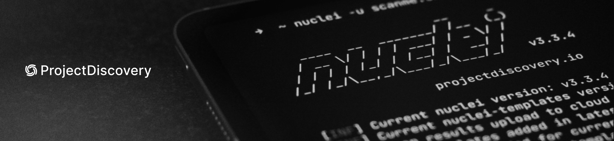

> Tradução automática local para português, ainda sem revisão humana integral. Estrutura e blocos de código preservados; referências externas não significam conteúdo espelhado.

# nuclei — documentação oficial



<div align="center">

<a href="https://github.com/projectdiscovery/nuclei/blob/main/README.md">`English`</a> •
<a href="https://github.com/projectdiscovery/nuclei/blob/main/README_CN.md">`中文`</a> •
<a href="https://github.com/projectdiscovery/nuclei/blob/main/README_KR.md">`Korean`</a> •
<a href="https://github.com/projectdiscovery/nuclei/blob/main/README_ID.md">`Indonesia`</a> •
<a href="https://github.com/projectdiscovery/nuclei/blob/main/README_ES.md">`Spanish`</a> •
<a href="https://github.com/projectdiscovery/nuclei/blob/main/README_JP.md">`日本語`</a> •
<a href="https://github.com/projectdiscovery/nuclei/blob/main/README_PT-BR.md">`Portuguese`</a> •
<a href="https://github.com/projectdiscovery/nuclei/blob/main/README_TR.md">`Türkçe`</a> •
<a href="https://github.com/projectdiscovery/nuclei/blob/main/README_FA.md">`فارسی`</a>

</div>

<p align="center">

<a href="https://docs.projectdiscovery.io/tools/nuclei/overview?utm_source=github&utm_medium=web&utm_campaign=nuclei_readme"></a>
&nbsp;&nbsp;
<a href="https://github.com/projectdiscovery/nuclei-templates"></a>
&nbsp;&nbsp;
<a href="https://discord.gg/projectdiscovery?utm_source=github&utm_medium=web&utm_campaign=nuclei_readme"></a>

<hr>

</p>

<br>

**Nuclei é um scanner de vulnerabilidade moderno e de alto desempenho que aproveita modelos simples baseados em YAML. Ele capacita você a projetar cenários personalizados de detecção de vulnerabilidade que mimetizam as condições do mundo real, levando a zero falsos positivos.**

- Formato YAML simples para criar e personalizar modelos de vulnerabilidade.
- Fornecido por milhares de profissionais de segurança para lidar com vulnerabilidades em tendência.
- Reduza os falsos positivos simulando os passos do mundo real para verificar uma vulnerabilidade.
- Processamento ultra-rápido de varredura paralela e agrupamento de pedidos.
- Integre em pipelines CI/CD para detecção de vulnerabilidade e teste de regressão.
- Suporta vários protocolos como TCP, DNS, HTTP, SSL, WHOIS, JavaScript, Código e muito mais.
- Integrar com Jira, Splunk, GitHub, Elastic, GitLab.

<br>
<br>

## Sumário

- [**`Começar`**](#começar)
  - [_`1. Núcleos CLI`_](#1-nuclei-cli)
  - [_`2. Edições Pro e Enterprise`_](#2-edições-pro-e-enterprise)
- [**`Documentação`**](#documentação)
  - [_`Bandeiras de Linha de Comando`_](#bandeiras-de-linha-de-comando)
  - [_`Escaneamento único do alvo`_](#escaneamento-único-do-alvo)
  - [_`Analisando múltiplos alvos`_](#analisando-múltiplos-alvos)
  - [_`Varredura de rede`_](#varredura-de-rede)
  - [_`Analisando com seu modelo personalizado`_](#analisando-com-seu-modelo-personalizado)
  - [_`Ligar o Nuclei ao ProjectDiscovery_`_](#conecte-nuclei-ao-projectdiscovery)
- [**`Modelos Nuclei, Comunidade e Recompensas`**](#modelos-nuclei-comunidade-e-recompensas-)  💎
- [**`Nossa Missão`**](#nossa-missão)
- [**`Contribuidores`**](#contribuidores-coração)
- [**`Licença`**](#license)

<br>
<br>

## Começar

### **1. Nuclei CLI**

_Install Nuclei em sua máquina. Comece seguindo o guia de instalação [**`Aqui.`**](https://docs.projectdiscovery.io/tools/nuclei/install?utm_source=github&utm_medium=web&utm_campaign=nuclei_readme). Além disso, fornecemos [**`um nível de nuvem livre`**](https://cloud.projectdiscovery.io/sign-up) que vem com limites gratuitos mensais generosos:_

- Armazene e visualize seus achados de vulnerabilidade
- Escreva e gerencie seus modelos Nuclei
- Acesse os mais recentes modelos Nuclei
- Descubra e armazene seus alvos

> [!Importante]
> **Este projeto está em desenvolvimento ativo**. Espere quebrar alterações com lançamentos. Reveja o changelog de lançamento antes de atualizar.
> |:--------------------------------|
> □ Este projeto é construído principalmente para ser usado como uma ferramenta CLI autônoma. **Running núcleos como um serviço pode representar riscos de segurança.** Recomenda-se usar com cautela e medidas de segurança adicionais.

<br>

### **2. Edições Pro e Enterprise**

_Para equipes de segurança e empresas, fornecemos um serviço hospedado na nuvem construído em cima do Nuclei OSS, aprimorado para ajudá-lo a executar continuamente varreduras de vulnerabilidade em escala com sua equipe e fluxos de trabalho existentes:_

- Escaneamentos 50x mais rápidos
- Varredura em grande escala com alta precisão
- Integração com serviços de nuvem (AWS, GCP, Azure, Cloudflare, Fastly, Terraform, Kubernetes)
- Jira, Slack, Linear, APIs e Webhooks
- Relatórios executivos e de conformidade
- Além disso: Digitalização em tempo real, SAML SSO, plataforma compatível com SOC 2 (com opções de hospedagem UE e EUA), espaços de trabalho em equipe compartilhados e muito mais
- Estamos constantemente [**`adicionar novas funcionalidades`**](https://feedback.projectdiscovery.io/changelog)!
- **Ideal for:** Pentesters, equipes de segurança e empresas

[**`Inscreva-se no Pro`**](https://projectdiscovery.io/pricing?utm_source=github&utm_medium=web&utm_campaign=nuclei_readme) ou [**`Fale com a nossa equipa`**](https://projectdiscovery.io/request-demo?utm_source=github&utm_medium=web&utm_campaign=nuclei_readme) se você tiver uma grande organização e requisitos complexos.

<br>
<br>

## Documentação

Navegue pelo Nuclei [**`documentação aqui`**](https://docs.projectdiscovery.io/tools/nuclei/running) completo. Se você é novo para Nuclei, confira nosso [**`série básica do YouTube`**](https://www.youtube.com/playlist?list=PLZRbR9aMzTTpItEdeNSulo8bYsvil80Rl).

<div align="center">

<a href="https://www.youtube.com/watch?v=b5qMyQvL1ZA&list=PLZRbR9aMzTTpItEdeNSulo8bYsvil80Rl&utm_source=github&utm_medium=web&utm_campaign=nuclei_readme" target="_blank"></a> <a href="https://www.youtube.com/watch?v=nFXygQdtjyw&utm_source=github&utm_medium=web&utm_campaign=nuclei_readme" target="_blank"></a>

</div>

<br>

### Instalação

`nuclei` requer **go >= 1.27.3** para instalar com sucesso. Execute o seguinte comando para obter o repo:

```sh
go install -v github.com/projectdiscovery/nuclei/v3/cmd/nuclei@latest
```

Para saber mais sobre como instalar núcleos, consulte `https://docs.projectdiscovery.io/tools/nuclei/install`.

### Bandeiras de Linha de Comando

Para exibir todas as bandeiras para a ferramenta:

```sh
nuclei -h
```

<details>
<summary>Expand full help flags</summary>

```yaml
Nuclei is a fast, template based vulnerability scanner focusing
on extensive configurability, massive extensibility and ease of use.

Usage:
  ./nuclei [flags]

Flags:
TARGET:
   -u, -target string[]          target URLs/hosts to scan
   -l, -list string              path to file containing a list of target URLs/hosts to scan (one per line)
   -targets-inline string        inline multiline target list (for use in template profiles)
   -eh, -exclude-hosts string[]  hosts to exclude to scan from the input list (ip, cidr, hostname)
   -resume string                resume scan from and save to specified file (clustering will be disabled)
   -sa, -scan-all-ips            scan all the IP's associated with dns record
   -iv, -ip-version string[]     IP version to scan of hostname (4,6) - (default 4)
   -dun, -disable-url-normalization  keep targets exactly as supplied instead of collapsing urls that address the same resource
   -mup, -max-urls-per-pattern int   scan at most this many urls sharing one structural shape, e.g. /user/1 and /user/2 (0 to scan all)

TARGET-FORMAT:
   -im, -input-mode string        mode of input file (list, burp, jsonl, yaml, openapi, swagger, http) (default "list")
   -ro, -required-only            use only required fields in input format when generating requests
   -sfv, -skip-format-validation  skip format validation (like missing vars) when parsing input file
   -vtt, -vars-text-templating    enable text templating for vars in input file (only for yaml input mode)
   -vfp, -var-file-paths string[] list of yaml file contained vars to inject into yaml input

TEMPLATES:
   -nt, -new-templates                    run only new templates added in latest nuclei-templates release
   -ntv, -new-templates-version string[]  run new templates added in specific version
   -as, -automatic-scan                   automatic web scan using wappalyzer technology detection to tags mapping
   -t, -templates string[]                list of template or template directory to run (comma-separated, file)
   -turl, -template-url string[]          template url or list containing template urls to run (comma-separated, file)
   -ai, -prompt string                    generate and run template using ai prompt
   -w, -workflows string[]                list of workflow or workflow directory to run (comma-separated, file)
   -wurl, -workflow-url string[]          workflow url or list containing workflow urls to run (comma-separated, file)
   -validate                              validate the passed templates to nuclei
   -nss, -no-strict-syntax                disable strict syntax check on templates
   -td, -template-display                 displays the templates content
   -tl                                    list all templates matching current filters
   -tgl                                   list all available tags
   -sign                                  signs the templates with the private key defined in NUCLEI_SIGNATURE_PRIVATE_KEY env variable
   -code                                  enable loading code protocol-based templates
   -dut, -disable-unsigned-templates      disable running unsigned templates or templates with mismatched signature
   -esc, -enable-self-contained           enable loading self-contained templates
   -egm, -enable-global-matchers          enable loading global matchers templates
   -file                                  enable loading file templates
   -llm                                   enable llm matchers and extractors (semantic matching)
   -llm-provider string                   llm provider for semantic matching (openai, ollama, llamacpp, vllm, lmstudio, groq, openrouter, together, orcarouter) (default "openai")
   -llm-base-url string                   openai-compatible endpoint for semantic matching (overrides -llm-provider, e.g. a local model)
   -llm-model string                      model used for semantic matching
   -llm-timeout int                       time in seconds to wait for a single llm call (default 30)
   -llm-max-calls int                     maximum llm calls per scan (0 for unlimited) (default 5000)
   -llm-concurrency int                   maximum concurrent llm calls (default 4)
   -llm-cache                             cache llm responses within a scan (default true)

FILTERING:
   -a, -author string[]               templates to run based on authors (comma-separated, file)
   -tags string[]                     templates to run based on tags (comma-separated, file)
   -etags, -exclude-tags string[]     templates to exclude based on tags (comma-separated, file)
   -itags, -include-tags string[]     tags to be executed even if they are excluded either by default or configuration
   -id, -template-id string[]         templates to run based on template ids (comma-separated, file, allow-wildcard)
   -eid, -exclude-id string[]         templates to exclude based on template ids (comma-separated, file)
   -it, -include-templates string[]   path to template file or directory to be executed even if they are excluded either by default or configuration
   -et, -exclude-templates string[]   path to template file or directory to exclude (comma-separated, file)
   -em, -exclude-matchers string[]    template matchers to exclude in result
   -s, -severity value[]              templates to run based on severity. Possible values: info, low, medium, high, critical, unknown
   -es, -exclude-severity value[]     templates to exclude based on severity. Possible values: info, low, medium, high, critical, unknown
   -pt, -type value[]                 templates to run based on protocol type. Possible values: dns, file, http, headless, tcp, workflow, ssl, websocket, whois, code, javascript
   -ept, -exclude-type value[]        templates to exclude based on protocol type. Possible values: dns, file, http, headless, tcp, workflow, ssl, websocket, whois, code, javascript
   -tc, -template-condition string[]  templates to run based on expression condition

OUTPUT:
   -o, -output string            output file to write found issues/vulnerabilities
   -sresp, -store-resp           store all request/response passed through nuclei to output directory
   -srd, -store-resp-dir string  store all request/response passed through nuclei to custom directory (default "output")
   -silent                       display findings only
   -nc, -no-color                disable output content coloring (ANSI escape codes)
   -j, -jsonl                    write output in JSONL(ines) format
   -irr, -include-rr -omit-raw   include request/response pairs in the JSON, JSONL, and Markdown outputs (for findings only) [DEPRECATED use -omit-raw] (default true)
   -or, -omit-raw                omit request/response pairs in the JSON, JSONL, and Markdown outputs (for findings only)
   -ot, -omit-template           omit encoded template in the JSON, JSONL output
   -nm, -no-meta                 disable printing result metadata in cli output
   -ts, -timestamp               enables printing timestamp in cli output
   -rdb, -report-db string       nuclei reporting database (always use this to persist report data)
   -ms, -matcher-status          display match failure status
   -me, -markdown-export string  directory to export results in markdown format
   -se, -sarif-export string     file to export results in SARIF format
   -je, -json-export string      file to export results in JSON format
   -jle, -jsonl-export string    file to export results in JSONL(ine) format
   -pe, -pdf-export string       file to export results in PDF format
   -rd, -redact string[]         redact given list of keys from query parameter, request header and body

CONFIGURATIONS:
   -config string                        path to the nuclei configuration file
   -tp, -profile string                  template profile config file to run
   -tpl, -profile-list                   list community template profiles
   -fr, -follow-redirects                enable following redirects for http templates
   -fhr, -follow-host-redirects          follow redirects on the same host
   -mr, -max-redirects int               max number of redirects to follow for http templates (default 10)
   -dr, -disable-redirects               disable redirects for http templates
   -rc, -report-config string            nuclei reporting module configuration file
   -H, -header string[]                  custom header/cookie to include in all http request in header:value format (cli, file)
   -V, -var value                        custom vars in key=value format
   -r, -resolvers string                 file containing resolver list for nuclei
   -sr, -system-resolvers                use system DNS resolving as error fallback
   -dc, -disable-clustering              disable clustering of requests
   -passive                              enable passive HTTP response processing mode
   -fh2, -force-http2                    force http2 connection on requests
   -ev, -env-vars                        enable environment variables to be used in template
   -cc, -client-cert string              client certificate file (PEM-encoded) used for authenticating against scanned hosts
   -ck, -client-key string               client key file (PEM-encoded) used for authenticating against scanned hosts
   -ca, -client-ca string                client certificate authority file (PEM-encoded) used for authenticating against scanned hosts
   -sml, -show-match-line                show match lines for file templates, works with extractors only
   -ztls                                 use ztls library with autofallback to standard one for tls13 [Deprecated] autofallback to ztls is enabled by default
   -sni string                           tls sni hostname to use (default: input domain name)
   -dka, -dialer-keep-alive value        keep-alive duration for network requests.
   -lfa, -allow-local-file-access        allow all templates in the run to read any file on the system (not just payloads)
   -lna, -restrict-local-network-access  blocks connections to the local / private network
   -i, -interface string                 network interface to use for network scan
   -at, -attack-type string              type of payload combinations to perform (batteringram,pitchfork,clusterbomb)
   -pro, -payload-random-order           iterate payload combinations in a random order instead of sequentially
   -sip, -source-ip string               source ip address to use for network scan
   -rsr, -response-size-read int         max response size to read in bytes
   -rss, -response-size-save int         max response size to read in bytes (default 1048576)
   -rqss, -request-size-save int         max request body size to save in bytes (0 to save the whole body) (default 32768)
   -reset                                reset removes all nuclei configuration and data files (including nuclei-templates)
   -tlsi, -tls-impersonate               enable experimental client hello (ja3) tls randomization
   -hae, -http-api-endpoint string       experimental http api endpoint

INTERACTSH:
   -iserver, -interactsh-server string  interactsh server url for self-hosted instance (default: oast.pro,oast.live,oast.site,oast.online,oast.fun,oast.me)
   -itoken, -interactsh-token string    authentication token for self-hosted interactsh server
   -interactions-cache-size int         number of requests to keep in the interactions cache (default 5000)
   -interactions-eviction int           number of seconds to wait before evicting requests from cache (default 60)
   -interactions-poll-duration int      number of seconds to wait before each interaction poll request (default 5)
   -interactions-cooldown-period int    extra time for interaction polling before exiting (default 5)
   -ni, -no-interactsh                  disable interactsh server for OAST testing, exclude OAST based templates

FUZZING:
   -ft, -fuzzing-type string           overrides fuzzing type set in template (replace, prefix, postfix, infix)
   -fm, -fuzzing-mode string           overrides fuzzing mode set in template (multiple, single)
   -fuzz                               enable loading fuzzing templates (Deprecated: use -dast instead)
   -dast                               enable / run dast (fuzz) nuclei templates
   -dts, -dast-server                  enable dast server mode (live fuzzing)
   -dtr, -dast-report                  write dast scan report to file
   -dtst, -dast-server-token string    dast server token (optional)
   -dtsa, -dast-server-address string  dast server address (default "localhost:9055")
   -dtp, -dast-proxy                   enable dast proxy mode (fuzz live traffic proxied through nuclei)
   -dtpa, -dast-proxy-address string   dast proxy listen address (default "127.0.0.1:9056")
   -dtpau, -dast-proxy-auth string     dast proxy basic auth in user:pass format (required for non-loopback address)
   -dfp, -display-fuzz-points          display fuzz points in the output for debugging
   -fuzz-param-frequency int           frequency of uninteresting parameters for fuzzing before skipping (default 10)
   -fa, -fuzz-aggression string        fuzzing aggression level controls payload count for fuzz (low, medium, high) (default "low")
   -cs, -fuzz-scope string[]           in scope url regex to be followed by fuzzer
   -cos, -fuzz-out-scope string[]      out of scope url regex to be excluded by fuzzer

UNCOVER:
   -uc, -uncover                  enable uncover engine
   -uq, -uncover-query string[]   uncover search query
   -ue, -uncover-engine string[]  uncover search engine (shodan,censys,fofa,shodan-idb,quake,hunter,zoomeye,netlas,criminalip,publicwww,hunterhow,google) (default shodan)
   -uf, -uncover-field string     uncover fields to return (ip,port,host) (default "ip:port")
   -ul, -uncover-limit int        uncover results to return (default 100)
   -ur, -uncover-ratelimit int    override ratelimit of engines with unknown ratelimit (default 60 req/min) (default 60)

RATE-LIMIT:
   -rl, -rate-limit int               maximum number of requests to send per second (default 150)
   -rld, -rate-limit-duration value   maximum number of requests to send per second (default 1s)
   -host-backoff                      slow down a host that starts blocking (429, repeated 403s, connection failures)
   -host-backoff-max value            maximum delay applied to a host that is blocking (default 30s)
   -per-host-rate-limit               enable per-host rate limiting (global rate limit becomes unlimited when enabled)
   -rlm, -rate-limit-minute int       maximum number of requests to send per minute (DEPRECATED)
   -bs, -bulk-size int                maximum number of hosts to be analyzed in parallel per template (default 25)
   -c, -concurrency int               maximum number of templates to be executed in parallel (default 25)
   -hbs, -headless-bulk-size int      maximum number of headless hosts to be analyzed in parallel per template (default 10)
   -headc, -headless-concurrency int  maximum number of headless templates to be executed in parallel (default 10)
   -jsc, -js-concurrency int          maximum number of javascript runtimes to be executed in parallel (default 120)
   -pc, -payload-concurrency int      max payload concurrency for each template (default 25)
   -prc, -probe-concurrency int       http probe concurrency with httpx (default 50)
   -tlc, -template-loading-concurrency int  maximum number of concurrent template loading operations (default 50)

OPTIMIZATIONS:
   -timeout int                     time to wait in seconds before timeout (default 10)
   -retries int                     number of times to retry a failed request (default 1)
   -ldp, -leave-default-ports       leave default HTTP/HTTPS ports (eg. host:80,host:443)
   -mhe, -max-host-error int        max errors for a host before skipping from scan (default 30)
   -te, -track-error string[]       adds given error to max-host-error watchlist (standard, file)
   -nmhe, -no-mhe                   disable skipping host from scan based on errors
   -project                         use a project folder to avoid sending same request multiple times
   -project-path string             set a specific project path (default "/tmp")
   -spm, -stop-at-first-match       stop processing HTTP requests after the first match (may break template/workflow logic)
   -stream                          stream mode - start elaborating without sorting the input
   -ss, -scan-strategy value        strategy to use while scanning(auto/host-spray/template-spray) (default auto)
   -irt, -input-read-timeout value  timeout on input read (default 3m0s)
   -nh, -no-httpx                   disable httpx probing for non-url input
   -preflight-portscan              run preflight resolve + TCP portscan and filter targets before scanning (disabled by default)
   -no-stdin                        disable stdin processing

HEADLESS:
   -headless                        enable templates that require headless browser support (root user on Linux will disable sandbox)
   -page-timeout int                seconds to wait for each page in headless mode (default 20)
   -sb, -show-browser               show the browser on the screen when running templates with headless mode
   -ho, -headless-options string[]  start headless chrome with additional options
   -sc, -system-chrome              use local installed Chrome browser instead of nuclei installed
   -cdpe, -cdp-endpoint string      use remote browser via Chrome DevTools Protocol (CDP) endpoint
   -lha, -list-headless-action      list available headless actions

DEBUG:
   -debug                     show all requests and responses
   -dreq, -debug-req          show all sent requests
   -dresp, -debug-resp        show all received responses
   -p, -proxy string[]        list of http/socks5 proxy to use (comma separated or file input)
   -pi, -proxy-internal       proxy all internal requests
   -rp, -replay-proxy string  http/socks5 proxy to re-send requests that produced a finding through (e.g. burp)
   -ldf, -list-dsl-function   list all supported DSL function signatures
   -tlog, -trace-log string   file to write sent requests trace log
   -elog, -error-log string   file to write sent requests error log
   -version                   show nuclei version
   -hm, -hang-monitor         enable nuclei hang monitoring
   -v, -verbose               show verbose output
   -profile-mem string        generate memory (heap) profile & trace files
   -vv                        display templates loaded for scan
   -svd, -show-var-dump       show variables dump for debugging
   -vdl, -var-dump-limit int  limit the number of characters displayed in var dump (default 255)
   -ep, -enable-pprof         enable pprof debugging server
   -tv, -templates-version    shows the version of the installed nuclei-templates
   -hc, -health-check         run diagnostic check up

UPDATE:
   -up, -update                            update nuclei engine to the latest released version
   -ut, -update-templates                  update nuclei-templates to latest released version
   -utc, -update-templates-channel string  nuclei-templates update channel (stable, latest) (default "stable")
   -ud, -update-template-dir string        custom directory to install / update nuclei-templates
   -duc, -disable-update-check             disable automatic nuclei/templates update check

HONEYPOT:
   -hpd, -honeypot-detect            detect potential honeypot hosts based on match concentration
   -hpt, -honeypot-threshold int     number of distinct template IDs required to flag a honeypot host (default 15)
   -shp, -suppress-honeypot          suppress output for flagged honeypot hosts

STATISTICS:
   -stats                    display statistics about the running scan
   -sj, -stats-json          display statistics in JSONL(ines) format
   -si, -stats-interval int  number of seconds to wait between showing a statistics update (default 5)
   -mp, -metrics-port int    port to expose nuclei metrics on (default 9092)
   -hps, -http-stats         enable http status capturing (experimental)

CLOUD:
   -auth                           configure projectdiscovery cloud (pdcp) api key (default true)
   -tid, -team-id string           upload scan results to given team id (optional) (default "none")
   -cup, -cloud-upload             upload scan results to pdcp dashboard [DEPRECATED use -dashboard]
   -sid, -scan-id string           upload scan results to existing scan id (optional)
   -sname, -scan-name string       scan name to set (optional)
   -pd, -dashboard                 upload / view nuclei results in projectdiscovery cloud (pdcp) UI dashboard
   -pdu, -dashboard-upload string  upload / view nuclei results file (jsonl) in projectdiscovery cloud (pdcp) UI dashboard

AUTHENTICATION:
   -sf, -secret-file string[]  path to config file containing secrets for nuclei authenticated scan
   -ps, -prefetch-secrets      prefetch secrets from the secrets file
   # NOTE: Headers in secrets files preserve exact casing (useful for case-sensitive APIs)


EXAMPLES:
Run nuclei on single host:
	$ nuclei -target example.com

Run nuclei with specific template directories:
	$ nuclei -target example.com -t http/cves/ -t ssl

Run nuclei against a list of hosts:
	$ nuclei -list hosts.txt

Run nuclei with a JSON output:
	$ nuclei -target example.com -json-export output.json

Run nuclei with sorted Markdown outputs (with environment variables):
	$ MARKDOWN_EXPORT_SORT_MODE=template nuclei -target example.com -markdown-export nuclei_report/

Additional documentation is available at: https://docs.projectdiscovery.io/getting-started/running

```

Documentação adicional está disponível em: [**`docs.projectdiscovery.io/getting-started/running`**](https://docs.projectdiscovery.io/getting-started/running?utm_source=github&utm_medium=web&utm_campaign=nuclei_readme)

</details>

### Escaneamento único do alvo

Para realizar uma rápida varredura na aplicação web:

```sh
nuclei -target https://example.com
```

### Analisando múltiplos alvos

O Nuclei pode lidar com a digitalização em massa fornecendo uma lista de alvos. Você pode usar um arquivo contendo várias URLs.

```sh
nuclei -list urls.txt
```

### Varredura de rede

Isto irá analisar toda a sub-rede para problemas relacionados à rede, tais como portas abertas ou serviços mal configurados.

```sh
nuclei -target 192.168.1.0/24
```

### Analisando com seu modelo personalizado

Para escrever e usar seu próprio modelo, crie um arquivo `.yaml` com regras específicas e, em seguida, use-o como segue.

```sh
nuclei -u https://example.com -t /path/to/your-template.yaml
```

### Conecte Nuclei ao ProjectDiscovery

Você pode executar as varreduras em sua máquina e enviar os resultados para a plataforma de nuvem para posterior análise e remediação.

```sh
nuclei -target https://example.com -dashboard
```

> [!NOTA]
> Este recurso é absolutamente gratuito e não requer qualquer assinatura. Para um guia detalhado, consulte o [**`documentação`**](https://docs.projectdiscovery.io/cloud/scanning/overview?utm_source=github&utm_medium=web&utm_campaign=nuclei_readme).

<br>
<br>

## Modelos Nuclei, comunidade e recompensas 💎
O [**Nuclei modelos**](https://github.com/projectdiscovery/nuclei-templates) baseia- se nos conceitos dos arquivos de modelos baseados no YAML que definem como as requisições serão enviadas e processadas. Isto permite capacidades de extensibilidade fáceis para os núcleos. Os modelos são escritos no YAML, que especifica um formato simples para leitura humana para definir rapidamente o processo de execução.

**Tente-o online com o nosso editor gratuito de modelos Nuclei alimentado por ** [**`clicando aqui`**](https://cloud.projectdiscovery.io/templates).

Nuclei Os modelos oferecem uma forma simplificada de identificar e comunicar vulnerabilidades, combinando detalhes essenciais, como classificações de gravidade e métodos de detecção.Esta ferramenta de código aberto, desenvolvida pela comunidade, acelera a resposta à ameaça e é amplamente reconhecida no mundo da segurança cibernética. Nuclei modelos são ativamente contribuídos por milhares de pesquisadores de segurança em todo o mundo. Nós executamos dois programas para nossos colaboradores: [**`Pioneiros`**](https://projectdiscovery.io/pioneers) e [**`□ recompensas`**](https://github.com/projectdiscovery/nuclei-templates/issues?q=is%3Aissue%20state%3Aopen%20label%3A%22%F0%9F%92%8E%20Bounty%22).


<p align="left">
    <a href="/static/nuclei-templates-teamcity.png"  target="_blank"></a>
</p>

#### Exemplos

Visite [Documentação **our**](https://docs.projectdiscovery.io/templates/introduction) para casos de uso e ideias.

|Caso de uso|Modelo Nuclei|
| :----------------------------------- | :------------------------------------------------- |
|Detecta CVEs conhecidos|**[CVE-2021-44228 (Log4Shell)](https://cloud.projectdiscovery.io/public/CVE-2021-45046)**|
|Identificar vulnerabilidades fora da banda|**[Injecção SQL Cega via OOB](https://cloud.projectdiscovery.io/public/CVE-2024-22120)**|
|Detecção por injecção SQL|**[Injeção SQL Genérica](https://cloud.projectdiscovery.io/public/CVE-2022-34265)**|
|Programação Cross- Site (XSS)|**[Detecção XSS refletida](https://cloud.projectdiscovery.io/public/CVE-2023-4173)**|
|Senhas padrão ou fraca|**[Verificação por Omissão de Credenciais](https://cloud.projectdiscovery.io/public/airflow-default-login)**|
|Arquivos secretos ou exposição de dados|**[Divulgação de arquivos Sensíveis](https://cloud.projectdiscovery.io/public/airflow-configuration-exposure)**|
|Identificar os redirecionamentos abertos|**[Abrir a Detecção de Redirecionamento](https://cloud.projectdiscovery.io/public/open-redirect)**|
|Detecta aquisições de subdomínios|**[Modelos de tomada de posse de subdomínios](https://cloud.projectdiscovery.io/public/azure-takeover-detection)**|
|Configurações incorretas de segurança|**[Consola Jenkins Desprotegida](https://cloud.projectdiscovery.io/public/unauthenticated-jenkins)**|
|Fracas configurações SSL/TLS|**[Expiração do certificado SSL](https://cloud.projectdiscovery.io/public/expired-ssl)**|
|Serviços de nuvem mal configurados|**[Abrir a Detecção de Balde S3](https://cloud.projectdiscovery.io/public/s3-public-read-acp)**|
|Vulnerabilidades de execução remota de código|**[Modelos de detecção RCE](https://cloud.projectdiscovery.io/public/CVE-2024-29824)**|
|Ataques de travessia de diretórios|**[Detecção de Traversal de Caminhos](https://cloud.projectdiscovery.io/public/oracle-fatwire-lfi)**|
|Vulnerabilidades de inclusão de arquivos|**[Inclusão de arquivos Local/ Remoto](https://cloud.projectdiscovery.io/public/CVE-2023-6977)**|


<br>
<br>

## Nossa Missão

Os scanners de vulnerabilidade tradicionais foram construídos décadas atrás. Eles são de código fechado, incrivelmente lentos e orientados por fornecedores. Os atacantes de hoje são em massa explorando CVEs recém-lançados na internet dentro de dias, ao contrário dos anos que ele costumava levar. Esta mudança requer uma abordagem completamente diferente para lidar com as façanhas de tendências na internet.

Construímos o Nuclei para resolver esse desafio. Tornamos todo o mecanismo de digitalização aberto e personalizável, permitindo que a comunidade global de segurança colaborasse e enfrentasse os vetores de ataque e vulnerabilidades na internet. O Nuclei agora é usado e contribuído por empresas da Fortune 500, agências governamentais, universidades.

Você pode participar contribuindo para o nosso código, [**`biblioteca de modelos`**](https://github.com/projectdiscovery/nuclei-templates), ou [**`juntando-se à nossa equipa`**](https://projectdiscovery.io/).

<br>
<br>

## Contribuidores: coração:

Graças a todo o incrível [**`contribuidores comunitários para o envio de PRs`**](https://github.com/projectdiscovery/nuclei/graphs/contributors) e manter este projeto atualizado. :heart:

<p align="left">
<a href="https://github.com/Ice3man543"></a>
<a href="https://github.com/apps/dependabot"></a>
<a href="https://github.com/ehsandeep"></a>
<a href="https://github.com/Mzack9999"></a>
<a href="https://github.com/forgedhallpass"></a>
<a href="https://github.com/tarunKoyalwar"></a>
<a href="https://github.com/manuelbua"></a>
<a href="https://github.com/actions-user"></a>
<a href="https://github.com/dogancanbakir"></a>
<a href="https://github.com/parrasajad"></a>
<a href="https://github.com/vzamanillo"></a>
<a href="https://github.com/ShubhamRasal"></a>
<a href="https://github.com/RamanaReddy0M"></a>
<a href="https://github.com/LuitelSamikshya"></a>
<a href="https://github.com/kchason"></a>
<a href="https://github.com/pmareke"></a>
<a href="https://github.com/dwisiswant0"></a>
<a href="https://github.com/xm1k3"></a>
<a href="https://github.com/5amu"></a>
<a href="https://github.com/ehrishirajsharma"></a>
<a href="https://github.com/zerodivisi0n"></a>
<a href="https://github.com/geeknik"></a>
<a href="https://github.com/TerminalFi"></a>
<a href="https://github.com/KaulSe"></a>
<a href="https://github.com/sullo"></a>
<a href="https://github.com/wdahlenburg"></a>
<a href="https://github.com/ghost"></a>
<a href="https://github.com/Nishan8583"></a>
<a href="https://github.com/jdk2588"></a>
<a href="https://github.com/nothinux"></a>
<a href="https://github.com/CodFrm"></a>
<a href="https://github.com/CasperGN"></a>
<a href="https://github.com/ankh2054"></a>
<a href="https://github.com/revblock"></a>
<a href="https://github.com/cn-kali-team"></a>
<a href="https://github.com/EndPositive"></a>
<a href="https://github.com/jimen0"></a>
<a href="https://github.com/xstevens"></a>
<a href="https://github.com/mjkim610"></a>
<a href="https://github.com/organiccrap"></a>
<a href="https://github.com/lu4nx"></a>
<a href="https://github.com/souvikhazra1"></a>
<a href="https://github.com/tovask"></a>
<a href="https://github.com/Marmelatze"></a>
<a href="https://github.com/doug-threatmate"></a>
<a href="https://github.com/yabeow"></a>
<a href="https://github.com/olearycrew"></a>
<a href="https://github.com/gano3s"></a>
<a href="https://github.com/alizmhdi"></a>
<a href="https://github.com/hackerpain"></a>
<a href="https://github.com/lc"></a>
<a href="https://github.com/savushkin-yauheni"></a>
<a href="https://github.com/74616e696d"></a>
<a href="https://github.com/edoardottt"></a>
<a href="https://github.com/zt2"></a>
<a href="https://github.com/moonD4rk"></a>
<a href="https://github.com/wk8"></a>
<a href="https://github.com/mikerott"></a>
<a href="https://github.com/toufik-airane"></a>
<a href="https://github.com/hktalent"></a>
<a href="https://github.com/jturner"></a>
<a href="https://github.com/gaby"></a>
<a href="https://github.com/vavkamil"></a>
<a href="https://github.com/leonjza"></a>
<a href="https://github.com/mionskowski-form3"></a>
<a href="https://github.com/chenrui333"></a>
<a href="https://github.com/iamargus95"></a>
<a href="https://github.com/shashikarsiddharth"></a>
<a href="https://github.com/trypa11"></a>
<a href="https://github.com/Zeokat"></a>
<a href="https://github.com/alban-stourbe-wmx"></a>
<a href="https://github.com/anykno"></a>
<a href="https://github.com/ronaudinho"></a>
<a href="https://github.com/boy-hack"></a>
<a href="https://github.com/iuliu8899"></a>
<a href="https://github.com/debasishbsws"></a>
<a href="https://github.com/denysvitali-niantic"></a>
<a href="https://github.com/fail-open"></a>
<a href="https://github.com/Xc1Ym"></a>
<a href="https://github.com/XTeam-Wing"></a>
<a href="https://github.com/Weltolk"></a>
<a href="https://github.com/tonghuaroot"></a>
<a href="https://github.com/praetorian-thendrickson"></a>
<a href="https://github.com/S0obi"></a>
<a href="https://github.com/skahn007gl"></a>
<a href="https://github.com/shouichi"></a>
<a href="https://github.com/seb-elttam"></a>
<a href="https://github.com/AdallomRoy"></a>
<a href="https://github.com/rotemreiss"></a>
<a href="https://github.com/oscarintherocks"></a>
<a href="https://github.com/xxcdd"></a>
<a href="https://github.com/chen2aaron"></a>
<a href="https://github.com/voidz0r"></a>
<a href="https://github.com/vince-isec"></a>
<a href="https://github.com/true13"></a>
<a href="https://github.com/skhalsa-sigsci"></a>
<a href="https://github.com/ShuBo6"></a>
<a href="https://github.com/seeyarh"></a>
<a href="https://github.com/securibee"></a>
<a href="https://github.com/sduc"></a>
<a href="https://github.com/scottdharvey"></a>
<a href="https://github.com/rykkard"></a>
<a href="https://github.com/monitor403"></a>
<a href="https://github.com/mlec1"></a>
<a href="https://github.com/meme-lord"></a>
<a href="https://github.com/LazyMaple"></a>
<a href="https://github.com/lvyaoting"></a>
<a href="https://github.com/llussy"></a>
<a href="https://github.com/linchizhen"></a>
<a href="https://github.com/kiokuless"></a>
<a href="https://github.com/Jarnpher553"></a>
<a href="https://github.com/c-f"></a>
<a href="https://github.com/hanghuge"></a>
<a href="https://github.com/testwill"></a>
<a href="https://github.com/galoget"></a>
<a href="https://github.com/fudancoder"></a>
<a href="https://github.com/revolunet"></a>
<a href="https://github.com/jsoref"></a>
<a href="https://github.com/MachadoOtto"></a>
<a href="https://github.com/jonathanwalker"></a>
<a href="https://github.com/nHurD"></a>
<a href="https://github.com/jessekelly881"></a>
<a href="https://github.com/JaneX8"></a>
<a href="https://github.com/eltociear"></a>
<a href="https://github.com/atomiczsec"></a>
<a href="https://github.com/M-Faheem-Khan"></a>
<a href="https://github.com/denandz"></a>
<a href="https://github.com/tibbon"></a>
<a href="https://github.com/dany74q"></a>
<a href="https://github.com/0x123456789"></a>
<a href="https://github.com/danigoland"></a>
<a href="https://github.com/ChrisMandich"></a>
<a href="https://github.com/austintraver"></a>
<a href="https://github.com/socialsister"></a>
<a href="https://github.com/Anemys"></a>
<a href="https://github.com/andreangelucci"></a>
<a href="https://github.com/AlexS778"></a>
<a href="https://github.com/noraj"></a>
<a href="https://github.com/akkuman"></a>
<a href="https://github.com/zrquan"></a>
<a href="https://github.com/1efty"></a>
<a href="https://github.com/rsrdesarrollo"></a>
<a href="https://github.com/razin99"></a>
<a href="https://github.com/MetzinAround"></a>
<a href="https://github.com/vil02"></a>
<a href="https://github.com/mrschyte"></a>
<a href="https://github.com/PeterDaveHello"></a>
<a href="https://github.com/parthmalhotra"></a>
<a href="https://github.com/owenrumney"></a>
<a href="https://github.com/Ovi3"></a>
<a href="https://github.com/Bisstocuz"></a>
<a href="https://github.com/daffainfo"></a>
<a href="https://github.com/mhmdiaa"></a>
<a href="https://github.com/MiryangJung"></a>
<a href="https://github.com/0xmin"></a>
<a href="https://github.com/maikthulhu"></a>
<a href="https://github.com/sttlr"></a>
<a href="https://github.com/iamRjarpan"></a>
<a href="https://github.com/leoloobeek"></a>
<a href="https://github.com/KristinnVikar"></a>
<a href="https://github.com/kant01ne"></a>
<a href="https://github.com/KeisukeYamashita"></a>
<a href="https://github.com/1hehaq"></a>
</p>

<br>
<br>
<br>

<div align="center">

<sub>**`nuclei`** é distribuído sob [Licença **MIT**](https://github.com/projectdiscovery/nuclei/blob/main/LICENSE.md)</sub>

</div>


---

## Procedência desta tradução

Fonte: [https://github.com/projectdiscovery/nuclei](https://github.com/projectdiscovery/nuclei/blob/263bc134120af1548023c23a9b55ec14f9217295/README.md). Licença: [MIT](../../99-Assets/upstream/nuclei/LICENSE.txt). Commit: 263bc134120af1548023c23a9b55ec14f9217295.

O original preservado, a lista de mudanças de apresentação e os hashes constam no manifesto do projeto. Nenhum exemplo desta documentação foi executado automaticamente.
