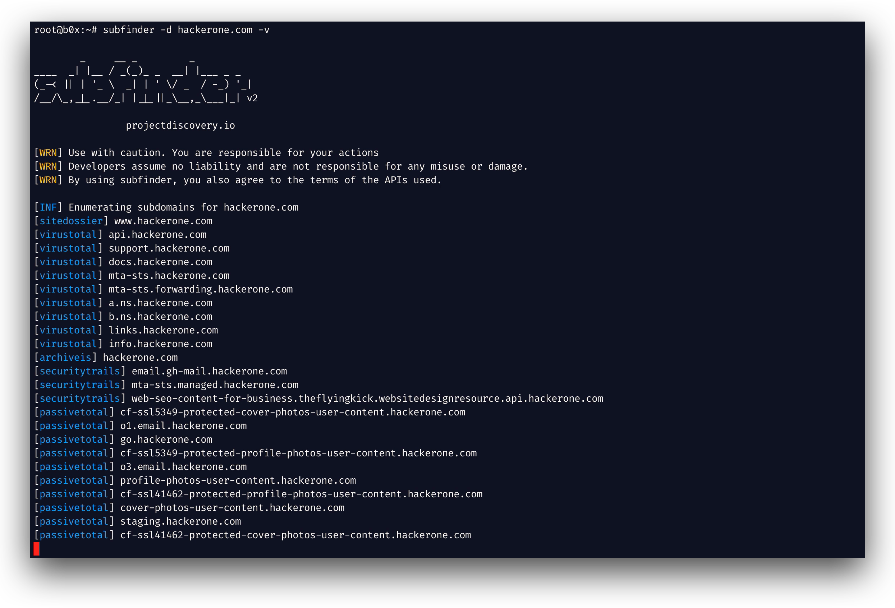

> Tradução automática local para português, ainda sem revisão humana integral. Estrutura e blocos de código preservados; referências externas não significam conteúdo espelhado.

<h1 align="center">
  
  <br>
</h1>

<h4 align="center">Fast passivo subdomínio enumeration tool.</h4>


<p align="center">
<a href="https://goreportcard.com/report/github.com/projectdiscovery/subfinder/v2"></a>
<a href="https://github.com/projectdiscovery/subfinder/issues"></a>
<a href="https://github.com/projectdiscovery/subfinder/releases"></a>
<a href="https://twitter.com/pdiscoveryio"></a>
<a href="https://discord.gg/projectdiscovery"></a>
</p>

<p align="center">
<a href="#features">Características</a> •
<a href="#installation">Install</a>
<a href="#a-executar-o-subfinder">Usage</a> •
<a href="#instruções-de-instalação-pós">API Configuração</a> •
<a href="#biblioteca-subfinder-go">Library</a> •
<a href="https://discord.gg/projectdiscovery">Join Discord</a>
</p>

---


`subfinder` é uma ferramenta de descoberta de subdomínios que retorna subdomínios válidos para sites, usando fontes online passivas. Tem uma arquitetura simples e modular e é otimizada para a velocidade. `subfinder` é construído para
fazendo apenas uma coisa - enumeração passiva do subdomínio, e faz isso muito bem.

Nós fizemos isso para cumprir com todas as licenças de fonte passivas usadas e restrições de uso. O modelo passivo garante velocidade e furtividade que podem ser alavancadas por testadores de penetração e recompensa de bug
Os caçadores são iguais.

# Features

<h1 align="left">
  </a>
  <br>
</h1>

- Módulos de resolução rápida e potente e eliminação wildcard
- **Curated** fontes passivas para maximizar os resultados
- Vários formatos de saída suportados (JSON, arquivo, stdout)
- Otimizado para velocidade e **peso leve** em recursos
- O suporte ao **STDIN/OUT** permite fácil integração em fluxos de trabalho

# Usage

```sh
subfinder -h
```

Isto irá mostrar a ajuda para a ferramenta. Aqui estão todos os interruptores que suporta.

```yaml
Usage:
  ./subfinder [flags]

Flags:
INPUT:
  -d, -domain string[]  domains to find subdomains for
  -dL, -list string     file containing list of domains for subdomain discovery

SOURCE:
  -s, -sources string[]           specific sources to use for discovery (-s crtsh,github). Use -ls to display all available sources.
  -recursive                      use only sources that can handle subdomains recursively (e.g. subdomain.domain.tld vs domain.tld)
  -all                            use all sources for enumeration (slow)
  -es, -exclude-sources string[]  sources to exclude from enumeration (-es alienvault,zoomeyeapi)

FILTER:
  -m, -match string[]     subdomain or list of subdomain to match (file or comma separated)
  -f, -filter string[]     subdomain or list of subdomain to filter (file or comma separated)
  -match-regex string[]   regex or list of regex to match on output subdomain (cli, file)
  -filter-regex string[]  regex or list of regex to filter on output subdomain (cli, file)

RATE-LIMIT:
  -rl, -rate-limit int  maximum number of http requests to send per second
  -rls value            maximum number of http requests to send per second for providers in key=value format (-rls "hackertarget=10/s,shodan=15/s")
  -t int                number of concurrent goroutines for resolving (-active only) (default 10)

UPDATE:
  -up, -update                 update subfinder to latest version
  -duc, -disable-update-check  disable automatic subfinder update check

OUTPUT:
  -o, -output string       file to write output to
  -oJ, -json               write output in JSONL format
  -oD, -output-dir string  directory to write output (-dL only)
  -cs, -collect-sources    include all sources in the output (-json only)
  -oI, -ip                 include host IP in output (-active only)

CONFIGURATION:
  -config string                flag config file (default "$CONFIG/subfinder/config.yaml")
  -pc, -provider-config string  provider config file (default "$CONFIG/subfinder/provider-config.yaml")
  -r string[]                   comma separated list of resolvers to use
  -rL, -rlist string            file containing list of resolvers to use
  -nW, -active                  display active subdomains only
  -proxy string                 http proxy to use with subfinder
  -ei, -exclude-ip              exclude IPs from the list of domains
  -mr, -max-results int         limit the number of results per source (0 = unlimited; honored by paginating sources)

DEBUG:
  -silent             show only subdomains in output
  -version            show version of subfinder
  -v                  show verbose output
  -nc, -no-color      disable color in output
  -ls, -list-sources  list all available sources (-oJ for JSON)

OPTIMIZATION:
  -timeout int                  seconds to wait before timing out (default 30)
  -max-time int                 minutes to wait for enumeration results (default 10)
  -rsr, -response-size-read int max response body size to read in bytes from passive sources (0 = unlimited)
```

<a id="environment-variables"></a>
## Variáveis de Ambiente

O Subfinder suporta variáveis de ambiente para especificar caminhos personalizados para arquivos de configuração:

- `SUBFINDER_CONFIG` - Caminho para o arquivo config.yaml (sobrepõe o arquivo padrão `$CONFIG/subfinder/config.yaml`)
- `SUBFINDER_PROVIDER_CONFIG` - Caminho para o arquivo provedor-config.yaml (overrides padrão `$CONFIG/subfinder/provider-config.yaml`)

# Installation

`subfinder` requer **go1.26.10** para instalar com sucesso. Execute o seguinte comando para instalar a versão mais recente:

```sh
go install -v github.com/projectdiscovery/subfinder/v2/cmd/subfinder@latest
```

Saiba mais sobre formas de instalar o subfinder aqui: https://docs.projectdiscovery.io/tools/subfinder/install.

<a id="post-installation-instructions"></a>
## Instruções de instalação pós

`subfinder` pode ser usado logo após a instalação, no entanto muitas fontes necessitaram de chaves API para funcionar. Saiba mais aqui: https://docs.projectdiscovery.io/tools/subfinder/install#post-install-configuration.

<a id="running-subfinder"></a>
## A executar o Subfinder

Saiba mais sobre como executar o Subfinder aqui: https://docs.projectdiscovery.io/tools/subfinder/running.

<a id="filtering-results-with-regular-expressions"></a>
### Filtrar os resultados com expressões regulares

`-match-regex` e `-filter-regex` tomam expressões regulares Go, repetidas ou de um arquivo (uma por linha), e combinam com `-match` e `-filter`:

```sh
subfinder -d example.com -match-regex '^(api|web)[0-9]{1,3}\.' -filter-regex '(^|\.)dev\.'
```

<a id="subfinder-go-library"></a>
## Biblioteca Subfinder Go

Subfinder também pode ser usado como biblioteca e um exemplo mínimo de usar o subfinder SDK está disponível [Aqui.](https://github.com/projectdiscovery/subfinder/blob/98ef8711acb91f52bc27a979e6c5320a6e1365ae/examples/main.go)

</td>
</tr>
</table>

<a id="resources"></a>
### Recursos

- [Recon comigo !!!](https://dhiyaneshgeek.github.io/bug/bounty/2020/02/06/recon-with-me/)

# License

`subfinder` é feito com 🖤 pela equipe [descoberta do projecto](https://projectdiscovery.io). Contribuições comunitárias fizeram o projeto o que é.
o arquivo **[Obrigado, Sr. Dr.](https://github.com/projectdiscovery/subfinder/blob/main/THANKS.md)** para mais detalhes.

Leia o aviso de uso em [DISCLAIMER.md](https://github.com/projectdiscovery/subfinder/blob/main/DISCLAIMER.md) e [contate-nos](mailto:contact@projectdiscovery.io) para qualquer remoção API.


---

## Procedência desta tradução

Fonte: [https://github.com/projectdiscovery/subfinder](https://github.com/projectdiscovery/subfinder/blob/98ef8711acb91f52bc27a979e6c5320a6e1365ae/README.md). Licença: [MIT](../../99-Assets/upstream/subfinder/LICENSE.txt). Commit: 98ef8711acb91f52bc27a979e6c5320a6e1365ae.

O original preservado, a lista de mudanças de apresentação e os hashes constam no manifesto do projeto. Nenhum exemplo desta documentação foi executado automaticamente.
